[English (Main README) → README.md](README.md)

# PBKK Pertemuan 9 — Framework CodeIgniter 4

## Identitas mahasiswa

| Identitas | Keterangan |
|---|---|
| Nama | **William Hans Chandra** |
| NRP | **5025241138** |
| Kelas | **Pemrograman Berbasis Kerangka Kerja D** |
| Materi | Framework CodeIgniter, Latihan 1 dan 2 |
| Proyek | StudentPortal, SIAKAD, KampusMart |

Dokumen ini merupakan laporan akademik implementasi tiga aplikasi dalam satu repository. Penjelasan, nama tabel, rute, aturan bisnis, dan potongan kode mengacu pada source yang disertakan. Seluruh gambar adalah render aplikasi sendiri melalui Chrome, bukan gambar dari laporan mahasiswa lain. Dokumentasi utama GitHub tersedia dalam [bahasa Inggris](README.md).

## Daftar isi

1. [Pendahuluan dan ruang lingkup](#1-pendahuluan-dan-ruang-lingkup)
2. [CodeIgniter 4 dan MVC](#2-codeigniter-4-dan-mvc)
3. [Lingkungan pengembangan](#3-lingkungan-pengembangan)
4. [Latihan 1 — StudentPortal](#4-latihan-1--studentportal)
5. [Latihan 2a — SIAKAD](#5-latihan-2a--siakad)
6. [Latihan 2b — KampusMart](#6-latihan-2b--kampusmart)
7. [Instalasi dari repository](#7-instalasi-dari-repository)
8. [Menjalankan dan mencoba aplikasi](#8-menjalankan-dan-mencoba-aplikasi)
9. [Pengujian dan hasil verifikasi](#9-pengujian-dan-hasil-verifikasi)
10. [Kendala teknis dan penyelesaian](#10-kendala-teknis-dan-penyelesaian)
11. [Pembelajaran](#11-pembelajaran)
12. [Referensi](#12-referensi)

## 1. Pendahuluan dan ruang lingkup

Latihan ini menerapkan framework PHP pada aplikasi yang memiliki kebutuhan berbeda, tetapi memakai pola pengembangan yang sama: routing eksplisit, controller, model, view, validasi, session, serta database relasional. StudentPortal memusatkan latihan pada halaman publik dan CRUD petugas. SIAKAD menambahkan relasi akademik dan aturan KRS. KampusMart menambahkan keranjang, transaksi stok, serta siklus pesanan.

| Pemetaan latihan | Aplikasi | Tujuan dan proses utama |
|---|---|---|
| Latihan 1 | StudentPortal | Direktori mahasiswa, program studi, petugas dan pesan kontak |
| Latihan 2a | SIAKAD | Pengelolaan akademik, perwalian, KRS, nilai, KHS dan transkrip |
| Latihan 2b | KampusMart | Katalog, keranjang, checkout, pembayaran manual dan pengiriman |

Ketiganya merupakan aplikasi terpisah pada satu repository. Tabel `users` pada StudentPortal tidak berbagi akun dengan tabel `users` pada SIAKAD atau KampusMart. Masing-masing mempunyai database, `.env`, direktori `writable/`, route, dan cookie sendiri. Pemisahan ini memudahkan penelusuran kode serta mencegah data dari satu latihan terbaca oleh aplikasi lain.

Database lokal yang sudah ada dipertahankan. Pada tahap penyiapan repository ini tidak dijalankan reset, seeder, checkout baru, perubahan nilai, atau mutasi data bisnis. Gambar memakai data dummy seeder dan riwayat QA yang memang telah tersimpan. Form upload/nilai yang terlihat berubah hanya merupakan pratinjau di browser, tanpa tombol simpan dikirim.

## 2. CodeIgniter 4 dan MVC

### 2.1 Peran framework

CodeIgniter menyediakan komponen routing, request/response, validasi, query builder, model, session, filter, pagination, migration, serta alat CLI Spark. Di aplikasi ini komponen-komponen tersebut dipakai untuk menghubungkan form browser dengan data MySQL tanpa menempatkan seluruh proses pada satu file PHP. Versi framework yang dipasang mengikuti `composer.lock`, bukan asumsi bahwa versi terbaru selalu sama.

### 2.2 Pembagian Model, View, Controller

| Lapisan | Contoh file aktual | Tanggung jawab |
|---|---|---|
| Route | [StudentPortal/app/Config/Routes.php](StudentPortal/app/Config/Routes.php) | Memilih controller dan filter berdasarkan URL serta metode HTTP |
| Controller | [StudentPortal/app/Controllers/Direktori.php](StudentPortal/app/Controllers/Direktori.php) | Membaca parameter pencarian dan mengirim data ke view |
| Model | [StudentPortal/app/Models/MahasiswaModel.php](StudentPortal/app/Models/MahasiswaModel.php) | Join program studi, validasi dan pagination mahasiswa |
| View | [StudentPortal/app/Views/pages/direktori.php](StudentPortal/app/Views/pages/direktori.php) | Menampilkan kartu mahasiswa dan form pencarian |
| Layanan domain | [SIAKAD/app/Libraries/KrsService.php](SIAKAD/app/Libraries/KrsService.php) | Menegakkan periode, SKS dan kuota tanpa bergantung pada tampilan tombol |

Alur direktori dimulai ketika browser meminta `GET /direktori?q=Andi`. Router menjalankan `Direktori::index()`, controller membaca `q` dan `prodi`, model membangun query dengan join dan filter, lalu view merender hasil beserta pager. Ketika tidak ditemukan data detail, controller mengembalikan 404. View tidak menyusun query SQL sendiri.

### 2.3 Perbandingan CI3 dan CI4 dalam konteks latihan

| Aspek | Pola CI3 | Pola CI4 yang dipakai pada repository |
|---|---|---|
| Struktur aplikasi | Umumnya direktori `application/` | `app/Controllers`, `app/Models`, `app/Views` |
| Namespace | Banyak kelas tanpa namespace | `App\Controllers`, `App\Models`, dan autoload PSR-4 |
| Controller/model | `CI_Controller`, `CI_Model` | `BaseController`, `CodeIgniter\Model` |
| Memuat view | Loader pada controller | Fungsi `view()` dan layout `extend/section` |
| Web root | Penempatan front controller pola lama | `public/index.php` sebagai pintu masuk |
| Alat pengembangan | Pola utilitas berbeda | Composer dan `php spark` untuk route/migration/server |

Perbandingan ini menjelaskan perbedaan pola; repository ini dimulai dari starter CI4 dan **bukan** hasil migrasi aplikasi CI3. Detail perbedaan dapat dirujuk pada [panduan resmi peningkatan CI3 ke CI4](https://codeigniter.com/user_guide/installation/upgrade_4xx.html). Keuntungan CI4 untuk latihan ini terlihat pada pemisahan direktori publik, namespace kelas, konfigurasi terstruktur, dan pengujian layanan bisnis.

## 3. Lingkungan pengembangan

| Komponen | Kebutuhan dan penggunaan | Versi pengembangan terverifikasi |
|---|---|---|
| Ubuntu | Pengembangan PHP/MySQL native Linux | 26.04.1 LTS |
| PHP | `^8.2` in each composer.json | 8.5.4 |
| CodeIgniter | `^4.7`, resolved by composer.lock | 4.7.6 |
| CI translations | Pesan validasi Bahasa Indonesia | 4.7.4 |
| MySQL | MySQLi driver, independent schemas | 8.4.11 |
| Composer | Memasang dependency PHP sesuai lockfile | 2.10.2 |
| Node / npm | Alat dokumentasi/browser opsional, bukan runtime PHP | 22.22.1 / 11.20.0 |
| SB Admin 2 | Aset administrator lokal | 4.1.4 |
| Bootstrap | Local Bootstrap 4 admin bundle; public storefront/portal CDN | 4 / 5.3.3 |
| Chart.js | Administrator and academic charts | 2.x bundled with SB Admin 2 |
| PHPUnit | Tes regresi aplikasi | 10.5.66 |

Kebutuhan minimum proyek adalah PHP `^8.2` sesuai `composer.json`; angka PHP 8.5.4 pada tabel adalah versi yang dipakai, bukan syarat minimum baru. Ekstensi `intl` dan `mbstring` diperlukan framework, `mysqli`/`mysqlnd` dipakai untuk koneksi, dan `fileinfo` mendukung pemeriksaan MIME upload. GD tersedia pada mesin pengembangan. XML/DOM diperlukan untuk PHPUnit. Node/npm hanya menjadi alat tambahan untuk pengambilan gambar dan audit browser, bukan syarat menjalankan server PHP.

Lingkungan memakai MySQL native Ubuntu, bukan XAMPP. Karena itu perintah `/opt/lampp/...` pada panduan diganti dengan `php`, `mysql`, dan Composer yang sudah tersedia. Tidak ada instalasi MariaDB atau penggantian layanan database. SB Admin 2 4.1.4 beserta jQuery, Bootstrap 4, Chart.js dan Font Awesome disediakan lokal; halaman publik memakai Bootstrap 5, Bootstrap Icons dan font CDN.

## 4. Latihan 1 — StudentPortal

### 4.1 Tujuan dan hak akses

StudentPortal menggabungkan direktori publik dengan panel administrasi mahasiswa. Pengunjung mencari mahasiswa dan program studi serta mengirim pesan. Staff menangani data mahasiswa sehari-hari. Admin mempunyai tambahan kewenangan terhadap program, akun petugas, dan penghapusan data.

| Fitur | Pengunjung | Staff | Admin |
|---|---|---|---|
| Beranda, direktori, profil dan program | Ya | Ya | Ya |
| Form kontak | Ya | Ya | Ya |
| Tambah/ubah mahasiswa dan foto | Tidak | Ya | Ya |
| Hapus mahasiswa | Tidak | Tidak | Ya |
| Baca pesan | Tidak | Ya | Ya |
| Kelola program, akun dan hapus pesan | Tidak | Tidak | Ya |


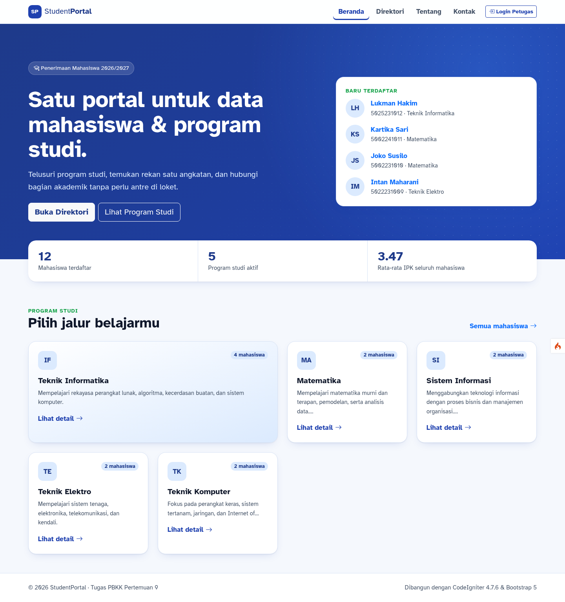

*Gambar 1. Beranda publik, sorotan program studi, dan statistik agregat.*

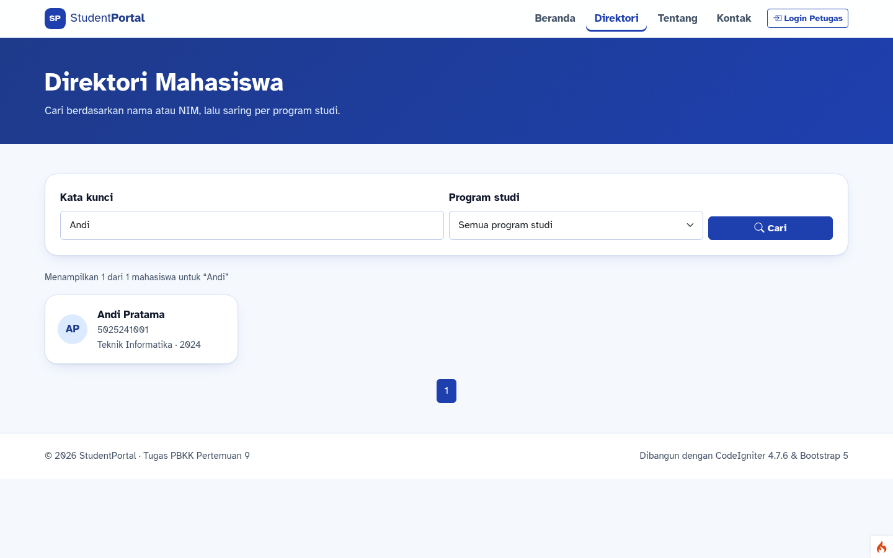

*Gambar 2. Direktori mahasiswa dengan pencarian nama nyata pada data dummy; direktori mendukung pagination.*

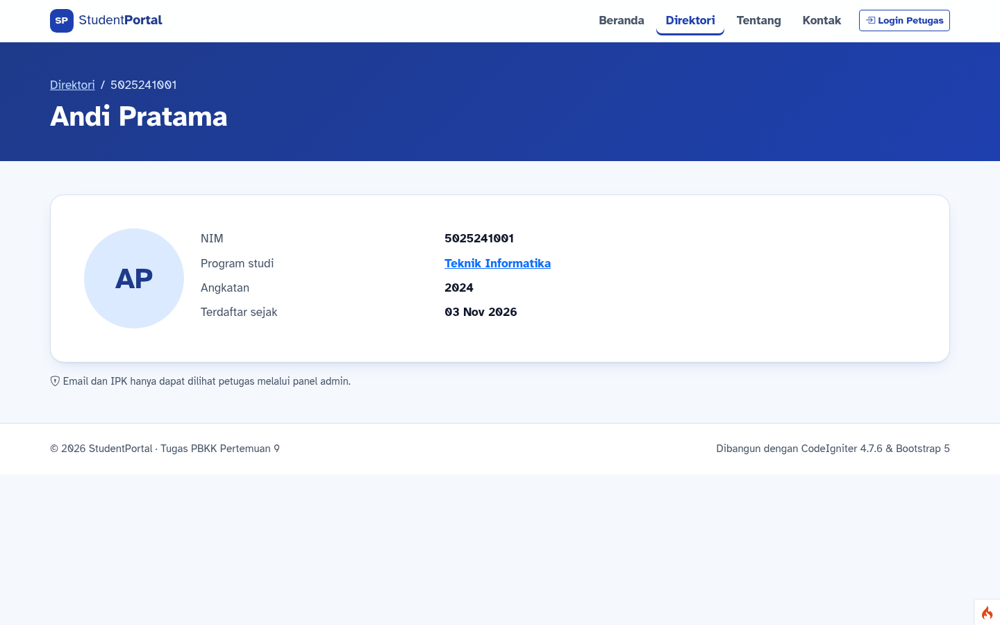

*Gambar 3. Profil mahasiswa publik; email dan IPK individual tidak ditampilkan.*

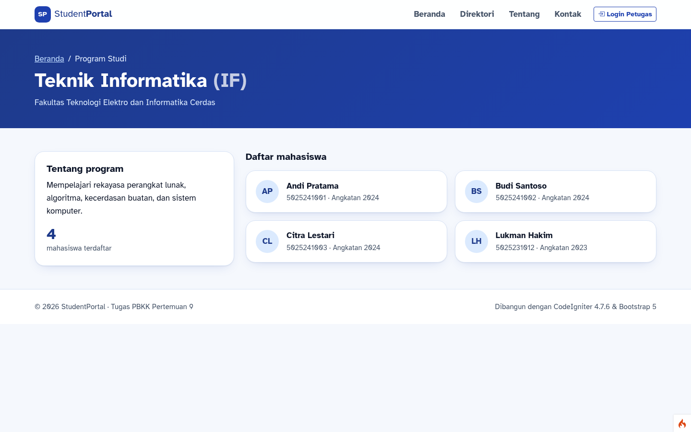

*Gambar 4. Detail program studi beserta daftar mahasiswanya.*


### 4.2 Persiapan, struktur dan konfigurasi

Pada pengembangan awal starter StudentPortal yang sudah ada dilanjutkan, lalu dependency translations dan aset SB Admin 2 disiapkan. Untuk mengambil versi repository ini, gunakan `composer install` di dalam StudentPortal; tidak perlu mengulang `composer create-project` dan menimpa source. Langkah lengkap konfigurasi database ada pada bagian instalasi bersama.

Konfigurasi menggunakan locale `id`, zona waktu `Asia/Jakarta`, `app.indexPage` kosong dan base URL port 8080. Helper form, URL dan text dimuat melalui BaseController. Layout publik dan admin dipisah agar halaman publik memakai Bootstrap 5 sedangkan panel admin memakai template SB Admin 2. Directory yang penting adalah `app/Views/layouts`, `partials`, `pages`, `auth`, serta `admin/{mahasiswa,program,users,pesan}`.

### 4.3 Routing dan controller

Route memisahkan GET untuk halaman, POST untuk pembuatan, PUT untuk perubahan dan DELETE untuk penghapusan. Form HTML tetap dikirim sebagai POST, lalu field `_method` menyatakan PUT atau DELETE. Logout juga menggunakan POST sehingga tautan gambar atau GET dari luar tidak langsung mengakhiri sesi.


[StudentPortal/app/Config/Routes.php](StudentPortal/app/Config/Routes.php)

```php
$routes->get('/', 'Home::index');
$routes->get('about', 'Pages::about');
$routes->get('contact', 'Pages::contact');
$routes->post('contact', 'Pages::kirimPesan');
$routes->get('direktori', 'Direktori::index');
$routes->get('mahasiswa/(:num)', 'Direktori::detail/$1');
$routes->get('program/(:segment)', 'Program::detail/$1');
```


Potongan tersebut menunjukkan bahwa form kontak dan halaman kontak memakai URL yang sama tetapi metode berbeda. Controller `Pages::kirimPesan()` mengambil hanya field yang diperlukan, menyerahkan validasi ke `PesanModel`, lalu memakai redirect dengan flash message. Setelah redirect, refresh halaman tidak mengulang POST sebelumnya. `Direktori` dan `Program` memisahkan pencarian serta detail, sementara controller pada namespace `Admin` menangani pengelolaan.

### 4.4 Model, migration dan relasi

| Tabel | Kolom penting | Peran dan aturan |
|---|---|---|
| `users` | id, nama, username, password_hash, role | Akun petugas; username unik; role admin/staff |
| `program_studi` | kode, nama, slug, fakultas, deskripsi | Master program; kode dan slug unik |
| `mahasiswa` | nim, nama, email, program_studi_id, angkatan, ipk, foto | NIM unik dan relasi ke program |
| `pesan` | nama, email, subjek, isi | Pesan dari form kontak |

Empat migration membentuk tabel-tabel tersebut. Foreign key `mahasiswa.program_studi_id` memakai RESTRICT saat program dihapus. Controller juga menghitung mahasiswa yang masih terhubung agar pengguna memperoleh pesan yang jelas sebelum constraint database bekerja. Nilai IPK menggunakan DECIMAL, bukan float, dan nama file foto disimpan terpisah dari isi berkas. Rincian seluruh kolom tersedia pada [desain database](docs/DATABASE.md).

Model membatasi `allowedFields` untuk mencegah field tambahan dari request tersimpan sembarangan. Aturan NIM berisi validasi numerik, panjang 10 digit, dan keunikan; IPK dibatasi 0–4. Placeholder ID pada validasi unik membuat edit data sendiri tidak dianggap sebagai duplikasi.


[StudentPortal/app/Models/MahasiswaModel.php](StudentPortal/app/Models/MahasiswaModel.php)

```php
    'nim'              => ['label' => 'NIM', 'rules' => 'required|numeric|exact_length[10]|is_unique[mahasiswa.nim,id,{id}]'],
    'nama'             => ['label' => 'Nama lengkap', 'rules' => 'required|min_length[3]|max_length[100]'],
    'email'            => ['label' => 'Email', 'rules' => 'required|valid_email|max_length[100]'],
    'program_studi_id' => ['label' => 'Program studi', 'rules' => 'required|is_not_unique[program_studi.id]'],
    'angkatan'         => ['label' => 'Angkatan', 'rules' => 'required|integer|greater_than_equal_to[2000]|less_than_equal_to[2030]'],
    'ipk'              => ['label' => 'IPK', 'rules' => 'required|decimal|greater_than_equal_to[0]|less_than_equal_to[4]'],
];
```


### 4.5 CRUD, pencarian dan pagination

CRUD mahasiswa memakai satu view form untuk tambah maupun edit. Form membawa isian lama ketika validasi gagal, sedangkan mode edit memakai ID dari route dan record yang ditemukan server. Program studi membentuk slug dari nama; akun petugas menyimpan hasil hash password, dan password kosong saat edit mempertahankan hash lama.

Pencarian membungkus kondisi LIKE nama/NIM/email dalam satu grup sebelum filter program diterapkan. Dengan demikian OR pencarian tidak membatalkan pembatasan program studi. Pagination memakai template Bootstrap yang sama antara tabel admin dan direktori, sedangkan query string pencarian dipertahankan saat pindah halaman.


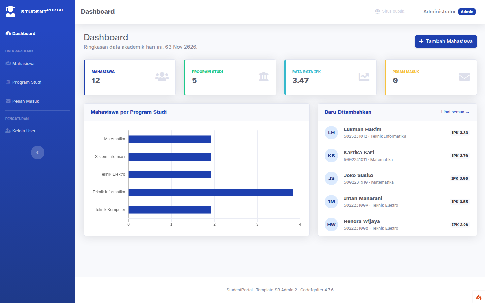

*Gambar 5. Dashboard administrator dan grafik Chart.js jumlah mahasiswa per program.*

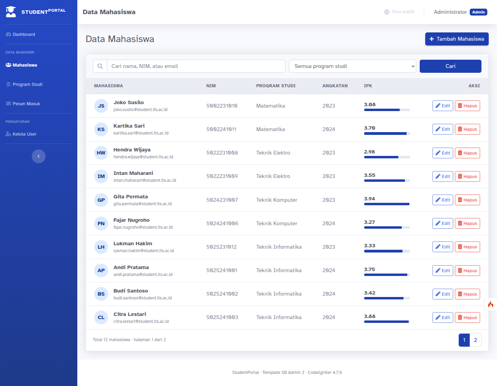

*Gambar 6. Daftar CRUD mahasiswa, filter program studi, dan pagination.*

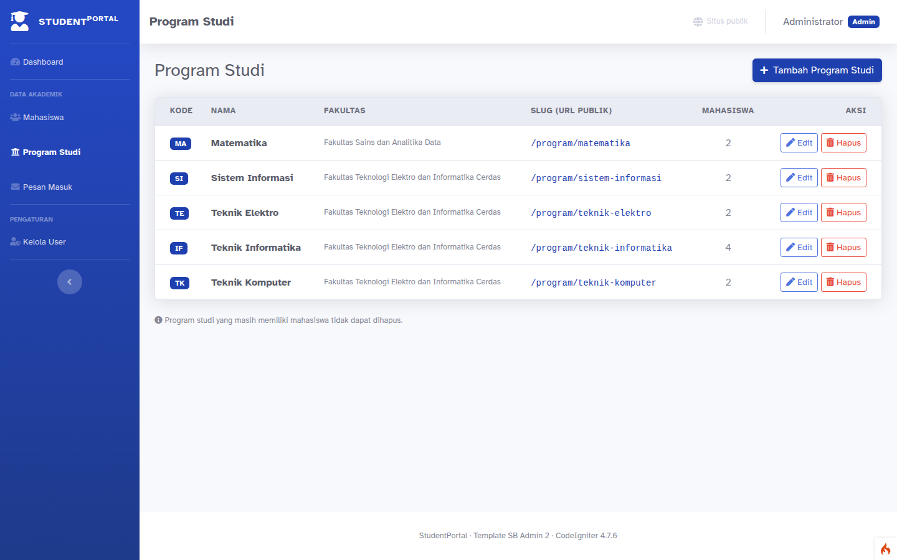

*Gambar 7. Pengelolaan program studi dan jumlah mahasiswa; program yang masih dipakai tidak dapat dihapus.*

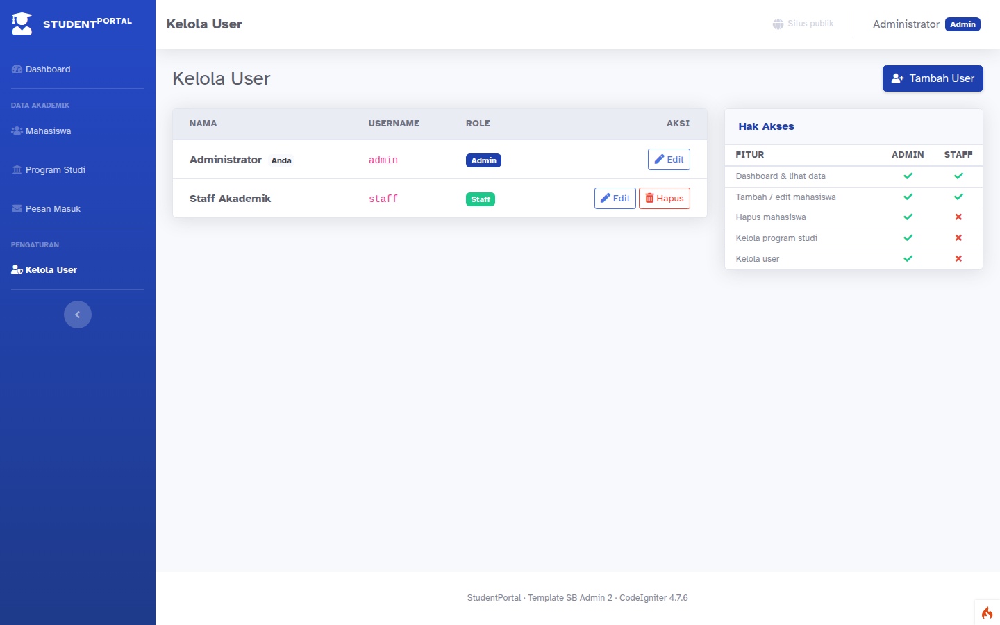

*Gambar 8. Pengelolaan akun petugas khusus admin beserta matriks hak akses.*


### 4.6 Upload foto dan validasi form

Upload foto tidak langsung dipercaya dari ekstensi nama file. Aturan server memeriksa file gambar, MIME, ekstensi JPG/JPEG/PNG/WebP dan ukuran maksimal 2 MB. Nama disamarkan dengan `getRandomName()`. Saat foto diganti atau dihapus, file lama dibersihkan menggunakan basename agar path tidak keluar dari direktori upload. Preview JavaScript hanya membantu pengguna melihat pilihan file; keputusan diterima atau ditolak tetap ada pada server.


[StudentPortal/app/Controllers/Admin/Mahasiswa.php](StudentPortal/app/Controllers/Admin/Mahasiswa.php)

```php
private const FOTO_RULES = [
    'label' => 'Foto',
    'rules' => 'uploaded[foto]'
        . '|is_image[foto]'
        . '|mime_in[foto,image/jpg,image/jpeg,image/png,image/webp]'
        . '|ext_in[foto,jpg,jpeg,png,webp]'
        . '|max_size[foto,2048]',
];
```


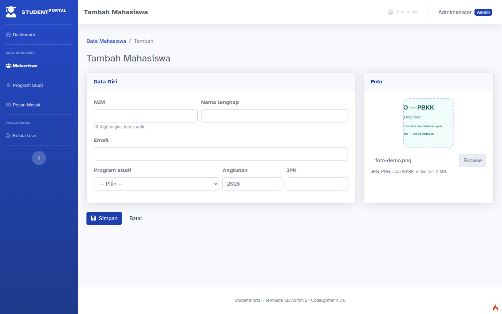

*Gambar 9. Form mahasiswa dengan pratinjau file fiktif melalui JavaScript aplikasi; tidak disimpan.*

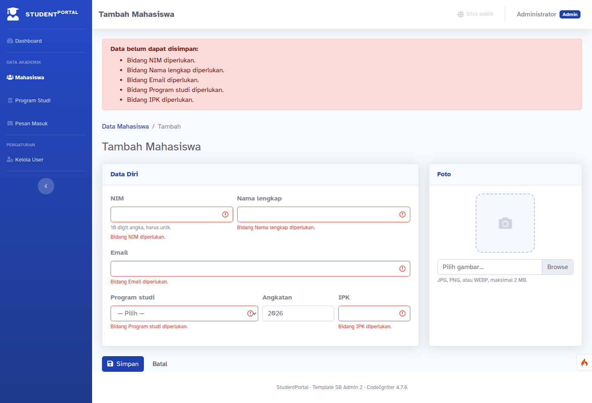

*Gambar 10. Validasi wajib isi di server setelah form kosong dikirim; tidak ada baris yang dimasukkan.*


Pada Gambar validasi, form kosong benar-benar dikirim untuk menampilkan error wajib isi; tidak ada record baru yang dapat memenuhi validasi. Pada gambar preview, file fiktif dipilih di browser tetapi form tidak disimpan. Kedua kondisi ini membuktikan perilaku UI tanpa membuat data dokumentasi baru.

### 4.7 Autentikasi, otorisasi dan kontak

Setelah password diverifikasi, session ID diregenerasi dan identitas/role petugas disimpan dalam session. Filter `auth` memerlukan login, `guest` mengarahkan pengguna yang sudah login keluar dari halaman login, dan `role:admin` membatasi operasi khusus admin. Menyembunyikan menu saja tidak cukup: filter dipasang pada route server sehingga request DELETE langsung oleh staff tetap ditolak. Admin juga tidak dapat menghapus atau menurunkan role akunnya sendiri.

CSRF aktif secara global dan setiap form menyertakan `csrf_field()`. Pesan, nama dan data lain pada view di-escape. Email dan IPK individual tidak ditampilkan pada profil publik; foto/avatar mahasiswa tetap dapat terlihat dan beranda hanya menampilkan statistik agregat. Kotak pesan pada saat capture kosong dan ditampilkan apa adanya, tanpa memasukkan pesan buatan.


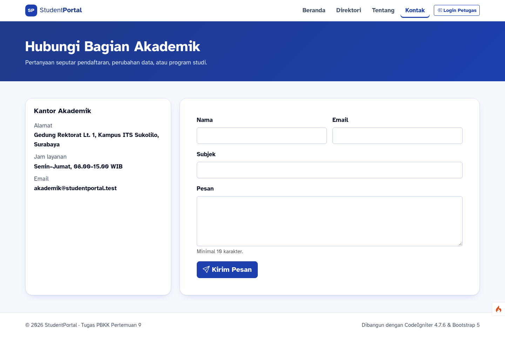

*Gambar 11. Formulir kontak dengan proteksi CSRF; pengambilan ini tidak mengirim pesan.*

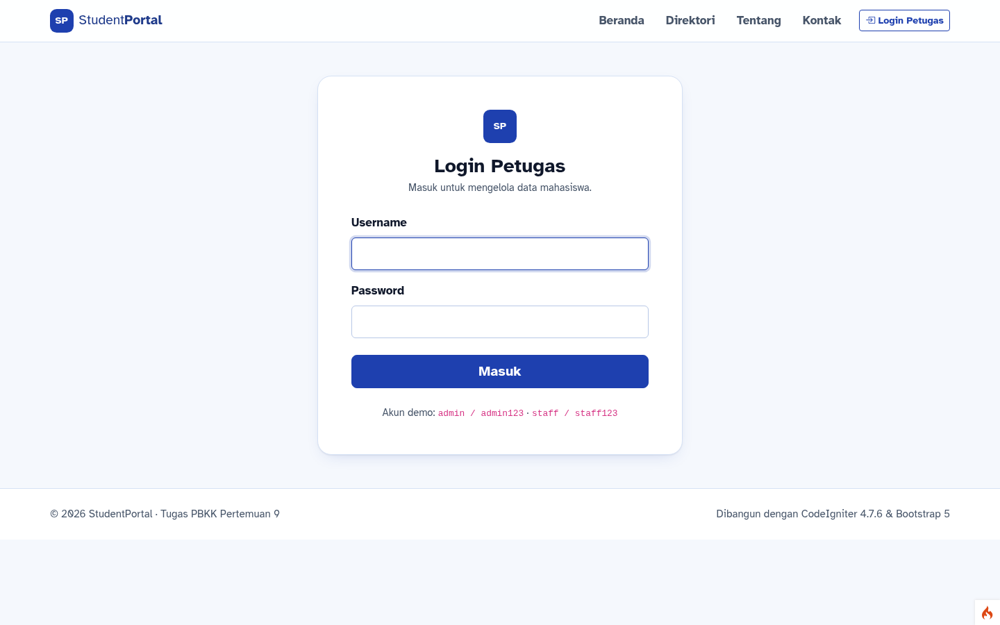

*Gambar 12. Halaman login petugas sebelum kredensial dimasukkan.*

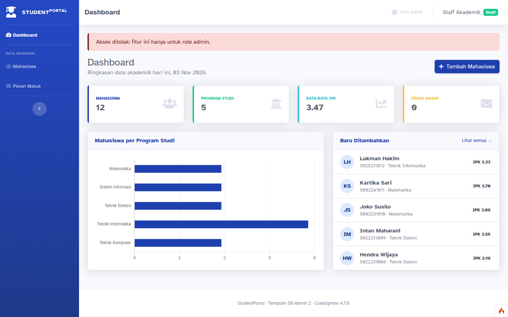

*Gambar 13. Penolakan akses nyata ketika staff membuka pengelolaan akun khusus admin.*

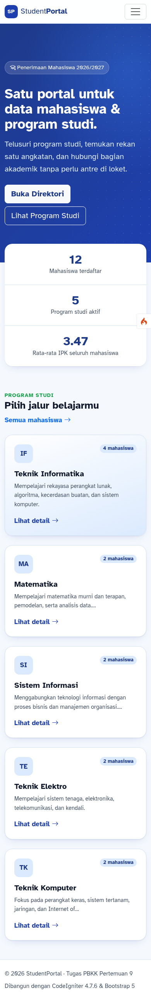

*Gambar 14. StudentPortal publik pada viewport mobile selebar 390 piksel.*

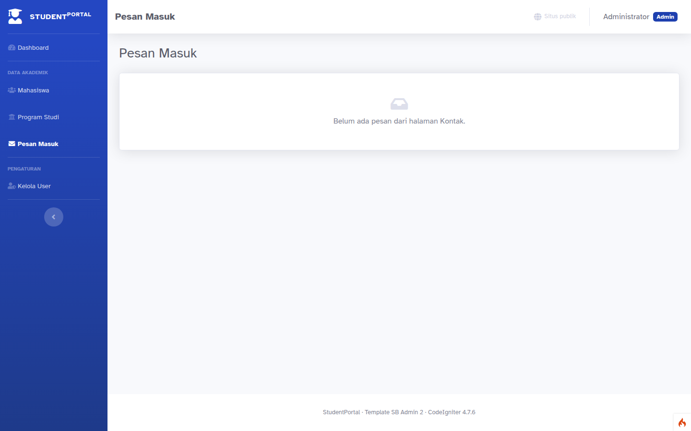

*Gambar 15. Kotak pesan saat ini kosong; tidak ada pesan baru yang dimasukkan demi dokumentasi.*


## 5. Latihan 2a — SIAKAD

### 5.1 Tujuan, role dan desain data

SIAKAD mengelola data akademik dengan perbedaan tanggung jawab admin, dosen dan mahasiswa. Admin menyiapkan data master. Dosen mengampu mata kuliah dan membimbing mahasiswa. Mahasiswa memilih mata kuliah yang memenuhi aturan dan membaca hasil studi miliknya sendiri.

| Fitur | Admin | Dosen | Mahasiswa |
|---|---|---|---|
| CRUD dosen, mahasiswa, mata kuliah | Ya | Tidak | Tidak |
| Provisioning/reset akun | Ya | Tidak | Tidak |
| Kelas sendiri dan input nilai | Tidak | Ya | Tidak |
| Mahasiswa perwalian sendiri | Tidak | Ya | Tidak |
| KRS, KHS dan transkrip sendiri | Tidak | Tidak | Ya |
| Ganti password sendiri | Ya | Ya | Ya |

| Tabel | Relasi dan isi |
|---|---|
| `users` | Username, hash password, nama dan role admin/dosen/mahasiswa |
| `dosen` | user_id unik, NIDN unik, email |
| `mahasiswa` | user_id unik, NIM unik, angkatan dan dosen_wali_id |
| `matakuliah` | kode unik, nama, SKS, semester kurikulum, dosen_id dan kuota |
| `krs` | mahasiswa, mata kuliah, tahun ajaran, semester dan nilai |

Relasi profil–user bersifat satu-ke-satu. Dosen dapat mengampu banyak mata kuliah dan menjadi wali banyak mahasiswa. Satu baris KRS menghubungkan satu mahasiswa dengan satu mata kuliah pada satu periode. Unique key empat kolom mencegah pengambilan mata kuliah yang sama dua kali dalam periode yang sama. Nilai boleh NULL untuk menyatakan belum dinilai, bukan nilai nol.


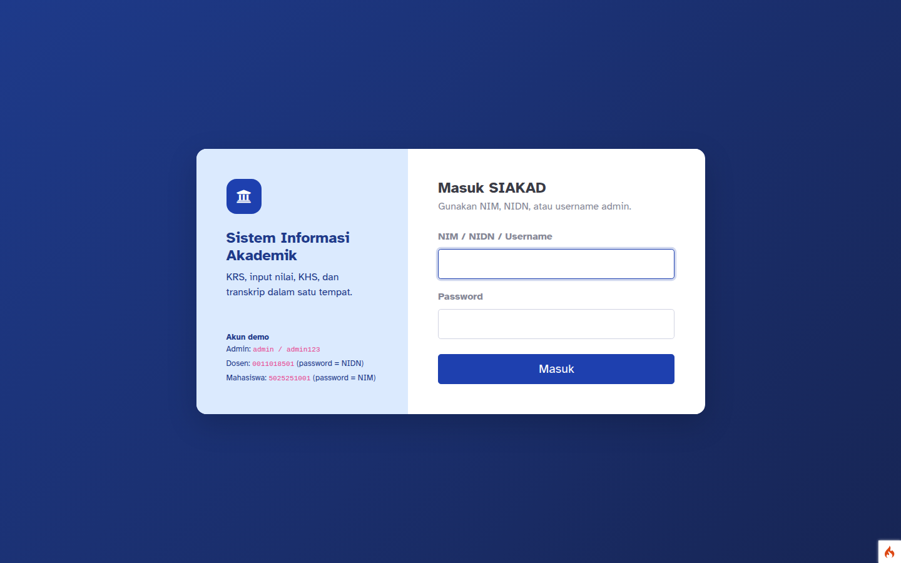

*Gambar 16. Login akademik dan akun demonstrasi fiktif dari seeder.*

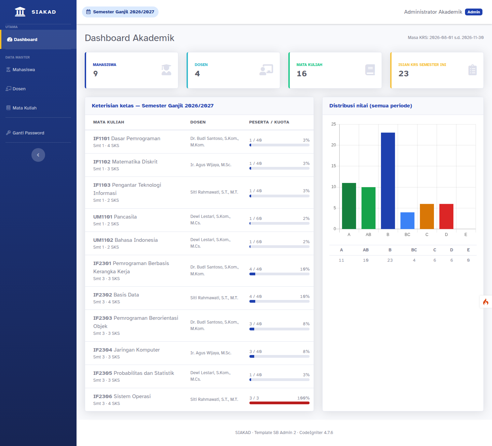

*Gambar 17. Dashboard administrator akademik: data master, nilai, dan keterisian kelas.*

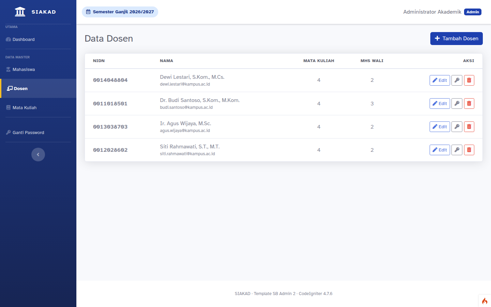

*Gambar 18. Profil dosen yang terhubung ke akun login.*

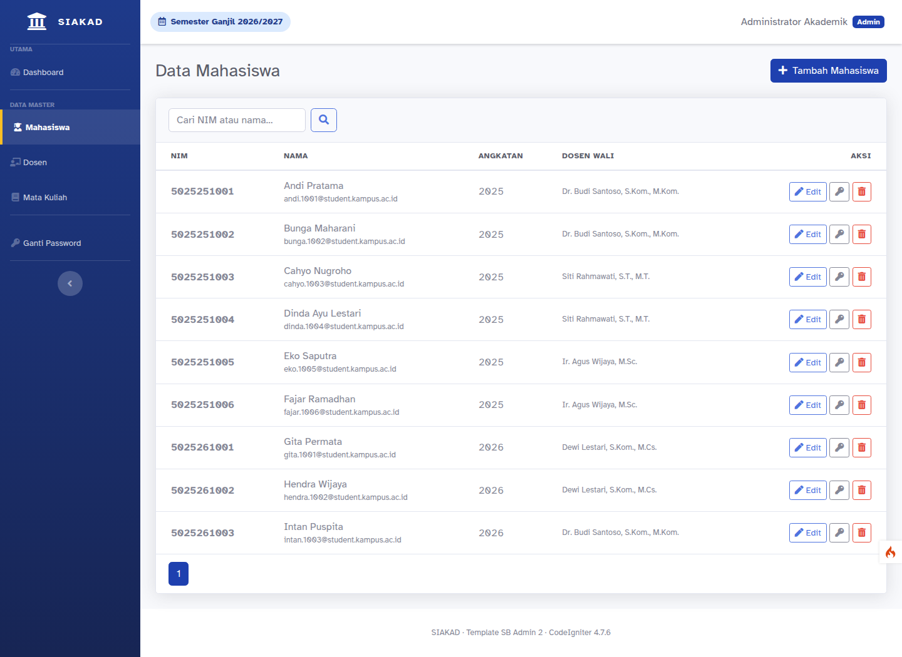

*Gambar 19. Profil mahasiswa beserta dosen wali.*

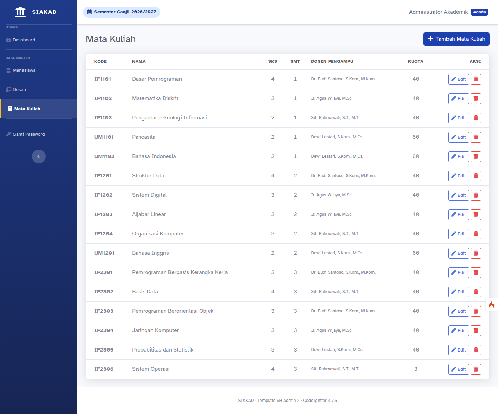

*Gambar 20. Data master mata kuliah: SKS, semester kurikulum, dosen pengampu, dan kuota.*

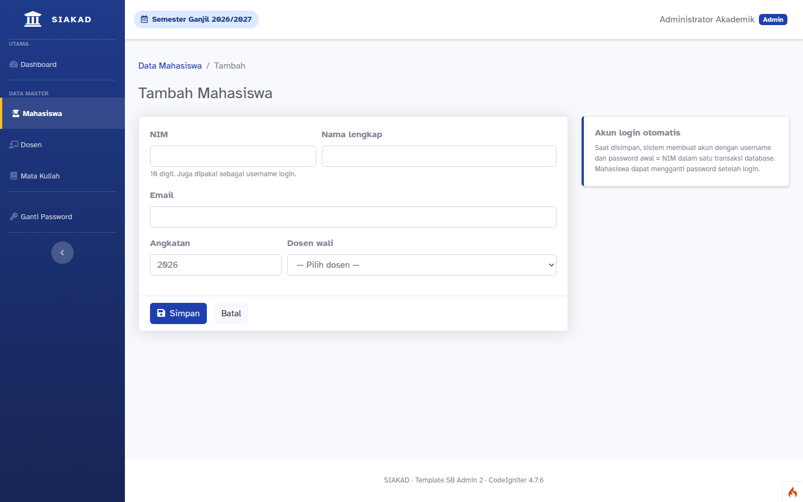

*Gambar 21. Form pembuatan mahasiswa; penyimpanan membuat akun dan profil, tetapi form ini tidak dikirim.*


### 5.2 Provisioning akun dan validasi data master

Pembuatan mahasiswa/dosen sekaligus membuat akun login dalam transaksi. NIM menjadi username serta password awal mahasiswa; NIDN menjalankan fungsi yang sama bagi dosen. Password awal selalu di-hash. Pengubahan profil memperbarui nama/username akun terkait agar tidak terpisah dari identitas akademiknya.

Admin tidak dapat menghapus mahasiswa yang telah mempunyai nilai. Dosen yang masih mengampu mata kuliah atau memiliki mahasiswa wali juga tidak dapat dihapus. Mata kuliah yang sudah direferensikan KRS dipertahankan. Aturan ini menjaga riwayat akademik, bukan sekadar menghilangkan tombol hapus.

### 5.3 KRS: periode, semester dan SKS

Konfigurasi berada pada [Akademik.php](SIAKAD/app/Config/Akademik.php). Periode aktif adalah 2026/2027 ganjil, dengan rentang KRS 1 Agustus sampai 30 November 2026 secara inklusif. Mata kuliah kurikulum semester 1, 3, 5 dan 7 dibuka pada semester ganjil; semester genap memakai 2, 4, 6 dan 8.

| IP semester sebelumnya | SKS maksimum |
|---|---:|
| Minimal 3,00 | 24 |
| Minimal 2,50 dan kurang dari 3,00 | 21 |
| Minimal 2,00 dan kurang dari 2,50 | 18 |
| Di bawah 2,00 | 15 |
| Belum mempunyai IP / mahasiswa baru | 20 |

Jadi aturan 24 SKS bukan batas yang diberikan kepada semua mahasiswa. Layanan menghitung IP periode sebelumnya, memilih batas sesuai konfigurasi, lalu menjumlahkan SKS yang sudah diambil. Mata kuliah yang sudah lulus minimal C tidak boleh diambil lagi; nilai D/E masih dapat diulang. Pembatalan hanya berlaku bagi KRS sendiri pada periode berjalan yang belum dinilai.


[SIAKAD/app/Libraries/KrsService.php](SIAKAD/app/Libraries/KrsService.php)

```php
public function periodeTerbuka(): bool
{
    $mulai   = Time::parse($this->akademik->krsMulai . ' 00:00:00');
    $selesai = Time::parse($this->akademik->krsSelesai . ' 23:59:59');

    return ! $this->sekarang->isBefore($mulai) && ! $this->sekarang->isAfter($selesai);
}
```


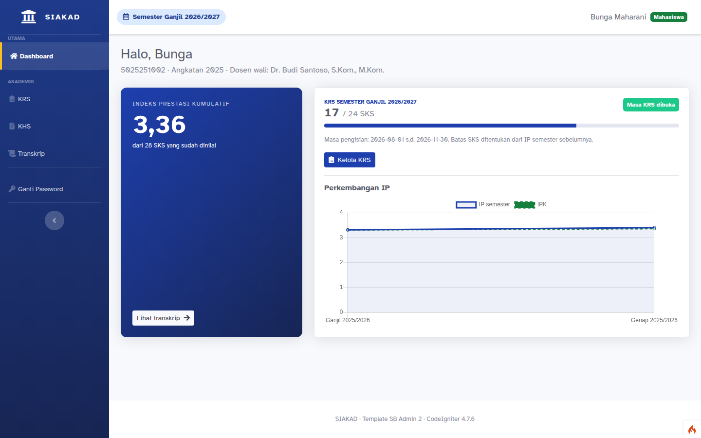

*Gambar 22. Dashboard mahasiswa dengan IPK, SKS lulus, dan batas SKS periode berjalan.*

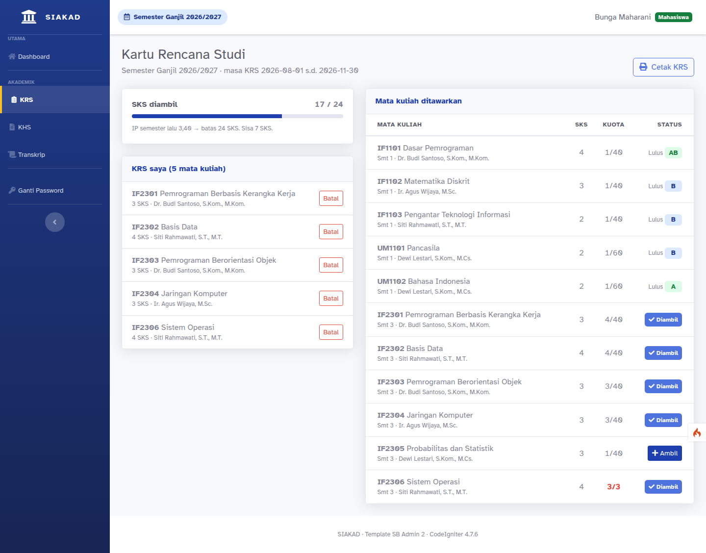

*Gambar 23. KRS yang sudah tersimpan dan penawaran mata kuliah semester ganjil.*

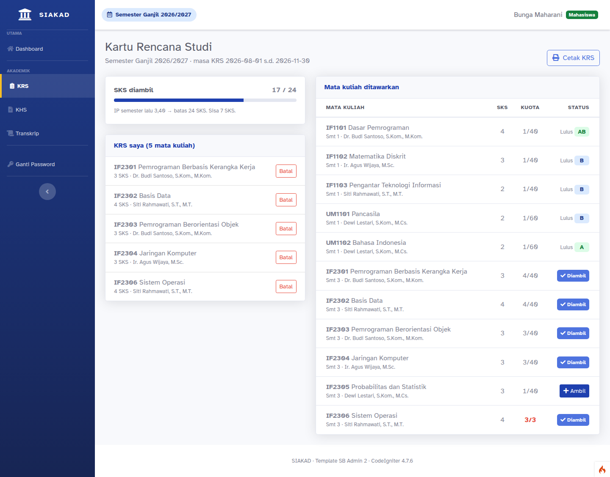

*Gambar 24. Kelas Sistem Operasi pada data seeder penuh; kapasitas ditampilkan tanpa mengubah KRS.*


### 5.4 Transaksi dan request bersamaan

Pengecekan SKS di luar transaksi dapat menerima dua permintaan yang masing-masing melihat sisa SKS lama. Implementasi mengunci baris mahasiswa terlebih dahulu sehingga dua sesi untuk mahasiswa yang sama dihitung berurutan. Baris mata kuliah kemudian dikunci untuk menyelaraskan pengecekan kuota. Peserta dibaca menggunakan locking read agar tidak bergantung pada snapshot lama pada isolasi MySQL REPEATABLE READ.


[SIAKAD/app/Libraries/KrsService.php](SIAKAD/app/Libraries/KrsService.php)

```php
// Serialize requests for one student before checking their total SKS and history.
$student = $db->query('SELECT id FROM mahasiswa WHERE id = ? FOR UPDATE', [$mahasiswaId])->getRowArray();
if ($student === null) {
    throw new DomainException('Mahasiswa tidak ditemukan.');
}
// A locking read sees the latest quota even with MySQL REPEATABLE READ.
$mk = $db->query('SELECT * FROM matakuliah WHERE id = ? FOR UPDATE', [$matakuliahId])->getRowArray();
if ($mk === null || ! $this->ditawarkan($mk)) {
    throw new DomainException('Mata kuliah tidak ditawarkan pada semester ini.');
}
```


Pada run implementasi sebelumnya, dua sesi mahasiswa yang sama bersaing mengambil dua mata kuliah tambahan ketika kapasitas SKS hampir habis; hanya satu diterima. Pengecekan kuota kelas penuh juga diuji. Pengujian yang menambah KRS tersebut tidak diulang pada tahap dokumentasi karena database harus tetap sama. Gambar kuota menampilkan kelas Sistem Operasi yang memang sudah penuh pada data seeder.

### 5.5 Dosen, perwalian dan input nilai

Session dosen menyimpan profil_id. Controller kelas membandingkan dosen pengampu dengan profil tersebut; kelas dosen lain menghasilkan 404. Input nilai hanya memproses ID KRS yang benar-benar menjadi peserta kelasnya. ID yang disisipkan dari kelas lain diabaikan. Seluruh nilai diperiksa terlebih dahulu; satu nilai invalid membuat batch tidak disimpan sebagian.

| Nilai angka minimum | Huruf | Bobot |
|---|---|---:|
| 85 | A | 4,0 |
| 80 | AB | 3,5 |
| 70 | B | 3,0 |
| 65 | BC | 2,5 |
| 55 | C | 2,0 |
| 40 | D | 1,0 |
| 0 | E | 0,0 |

Angka harus berada pada rentang 0–100. Preview JavaScript menampilkan huruf saat dosen mengetik; penyimpanan tetap mengonversi ulang melalui `Penilaian::huruf()` di server. Pada screenshot angka 88 diketik sehingga muncul A, tetapi tombol penyimpanan tidak dikirim.


[SIAKAD/app/Libraries/Penilaian.php](SIAKAD/app/Libraries/Penilaian.php)

```php
public function huruf(float $nilai): string
{
    if ($nilai < 0 || $nilai > 100) {
        throw new InvalidArgumentException('Nilai harus di antara 0 dan 100.');
    }

    foreach ($this->akademik->skala as $skala) {
        if ($nilai >= $skala['min']) {
            return $skala['huruf'];
        }
    }

    return 'E';
}
```


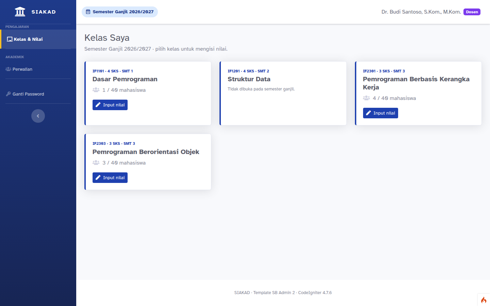

*Gambar 25. Tampilan dosen untuk kelas yang diampu dan jumlah peserta.*

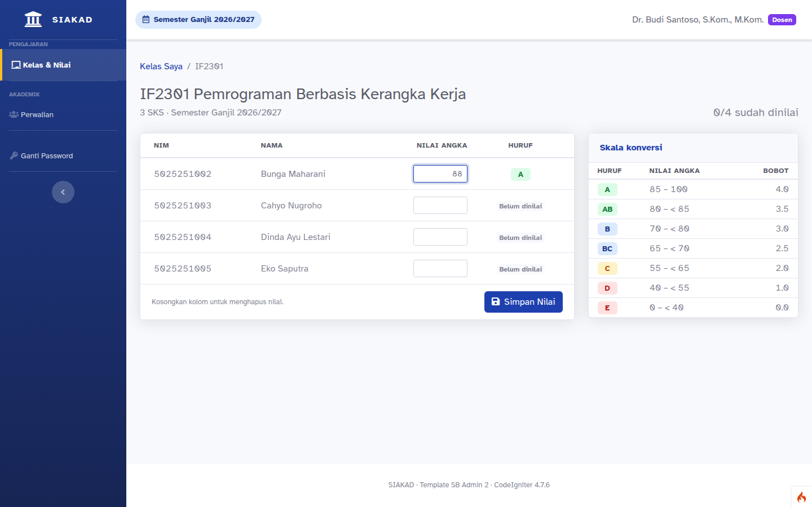

*Gambar 26. Form input nilai mempratinjau angka 88 sebagai A; perubahan tidak disimpan.*

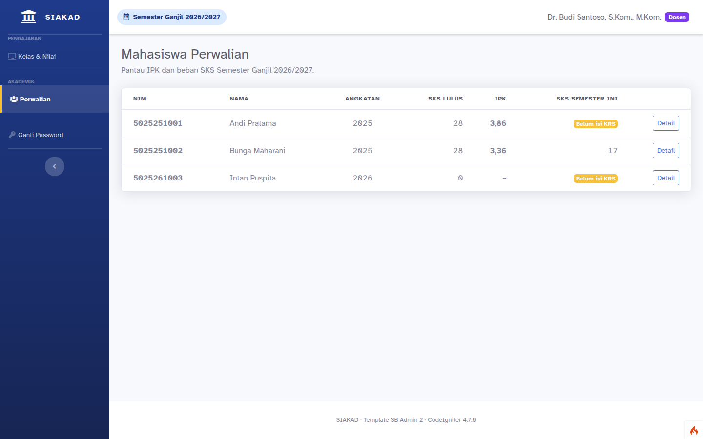

*Gambar 27. Daftar perwalian dosen beserta mahasiswa dan ringkasan IPK.*


### 5.6 KHS, IP, IPK, transkrip dan cetak

IP dihitung dengan rumus Σ(SKS × bobot) / ΣSKS untuk mata kuliah yang sudah dinilai. Baris NULL diabaikan. IPK memakai nilai terbaik per mata kuliah yang diulang sehingga satu mata kuliah tidak dihitung dua kali. Riwayat dikelompokkan per tahun ajaran dan semester untuk membuat KHS serta IPK kumulatif sampai periode tersebut.

KHS menampilkan nilai angka, huruf mutu, IP semester dan IPK kumulatif. Transkrip mengelompokkan nilai terbaik menurut semester kurikulum. Layout cetak tidak memakai sidebar dan menggunakan CSS A4; tombol print tidak ikut dicetak. Semua data mahasiswa diambil berdasarkan profil session, bukan ID mahasiswa bebas dari query string. Form ganti password memerlukan password lama, minimum delapan karakter untuk password baru, serta konfirmasi yang sama.


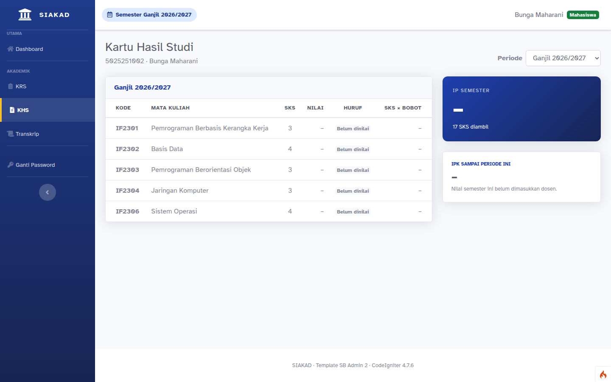

*Gambar 28. Kartu Hasil Studi per semester yang dihitung dari nilai seeder.*

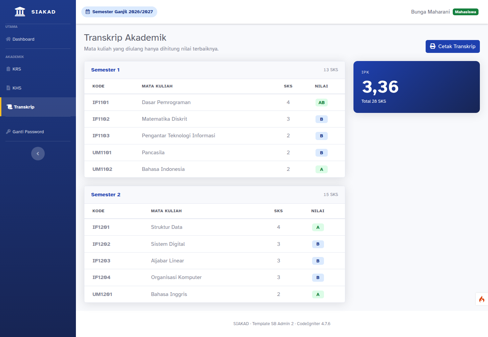

*Gambar 29. Transkrip yang memakai nilai terbaik untuk mata kuliah berulang.*

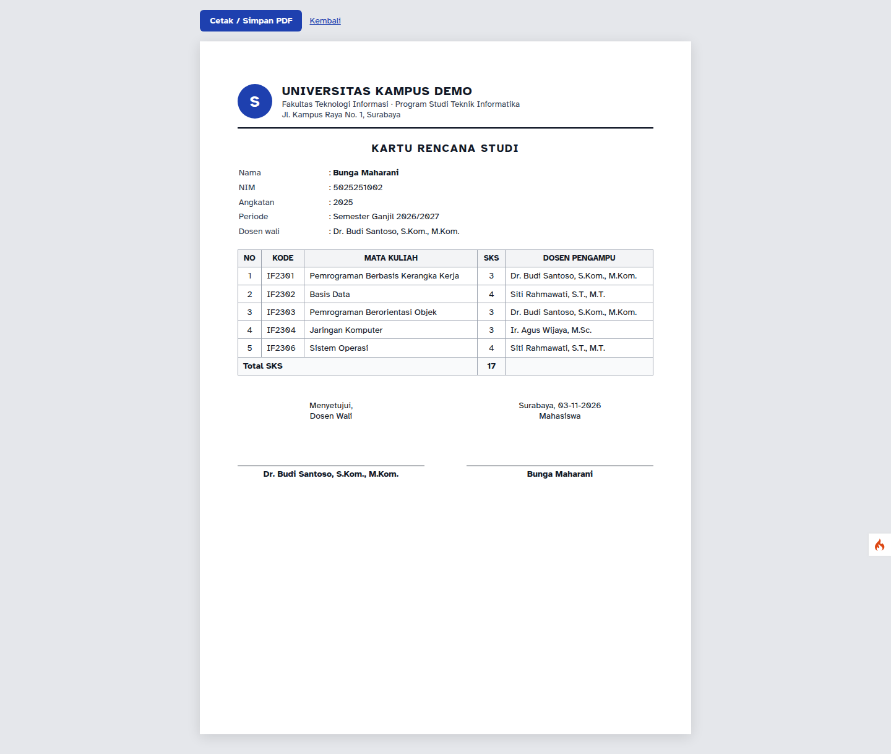

*Gambar 30. KRS siap cetak dengan area tanda tangan dosen wali.*

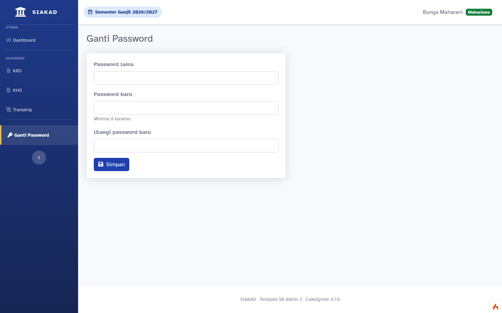

*Gambar 31. Form ganti password dengan seluruh input password kosong.*

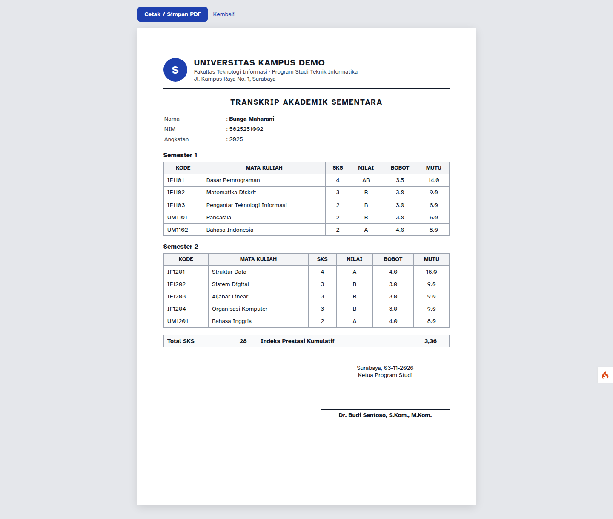

*Gambar 32. Transkrip siap cetak; gambar berasal dari render HTML view cetak sebenarnya.*

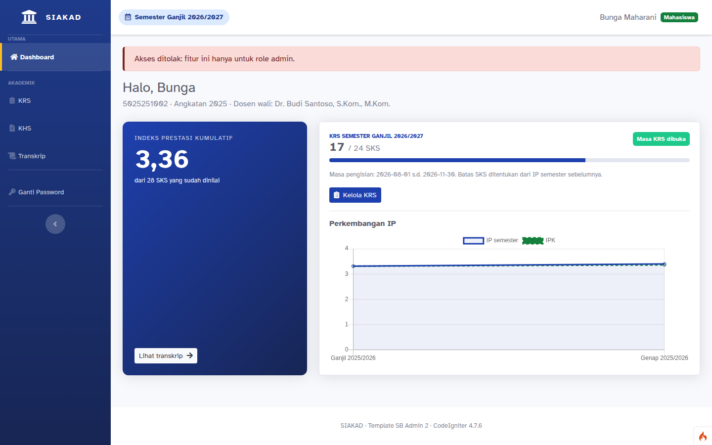

*Gambar 33. Akses mahasiswa ke route admin ditolak dan dialihkan ke dashboard mahasiswa.*


## 6. Latihan 2b — KampusMart

### 6.1 Storefront, katalog dan aktor

KampusMart merupakan toko perlengkapan kuliah dengan halaman publik Bootstrap 5 dan panel admin SB Admin 2. Pengunjung dapat menyusun keranjang sebelum login. Pembeli melakukan checkout, melampirkan bukti bayar dan memantau pesanannya. Admin menjaga data kategori/produk serta menangani proses pembayaran sampai pengiriman.

| Fitur | Pengunjung | Pembeli | Admin |
|---|---|---|---|
| Katalog, detail, pencarian dan keranjang sesi | Ya | Ya | Ya |
| Checkout dan riwayat pesanan sendiri | Tidak | Ya | Tidak |
| Upload bukti, batal yang diizinkan, terima pesanan | Tidak | Ya | Tidak |
| CRUD produk/kategori, verifikasi dan resi | Tidak | Tidak | Ya |

Katalog hanya menampilkan produk aktif. Pilihan urutan dipetakan ke daftar kolom yang diizinkan, sehingga query string tidak langsung menjadi SQL ORDER BY. Slug dipakai pada URL detail. Produk terkait dipilih dari kategori yang sama; produk terlaris dihitung dari item pesanan yang tidak dibatalkan. Gambar produk tanpa foto memakai placeholder ikon kategori dari aplikasi, bukan gambar milik orang lain.


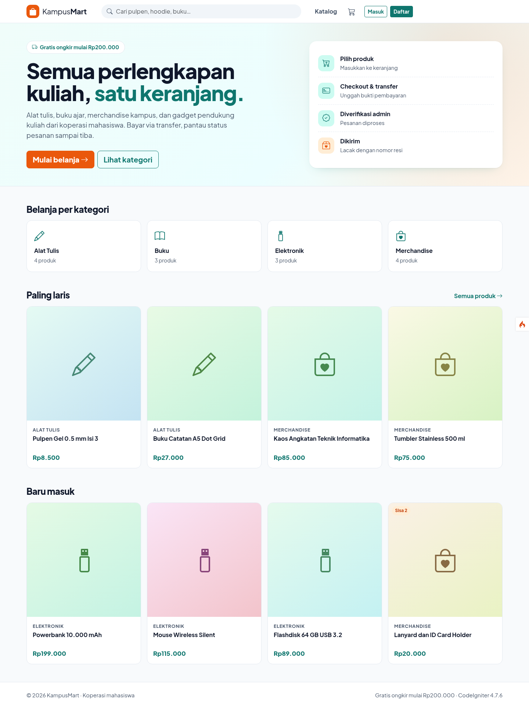

*Gambar 34. Beranda toko dengan kategori, produk terlaris, dan produk terbaru.*

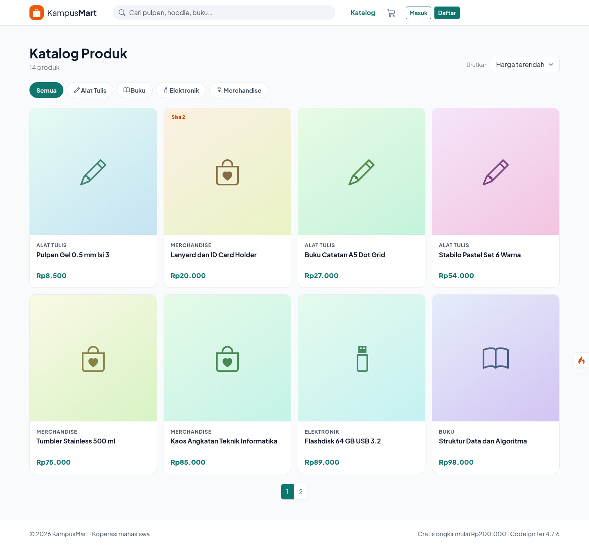

*Gambar 35. Katalog diurutkan dari harga terendah, dengan pencarian dan filter kategori.*

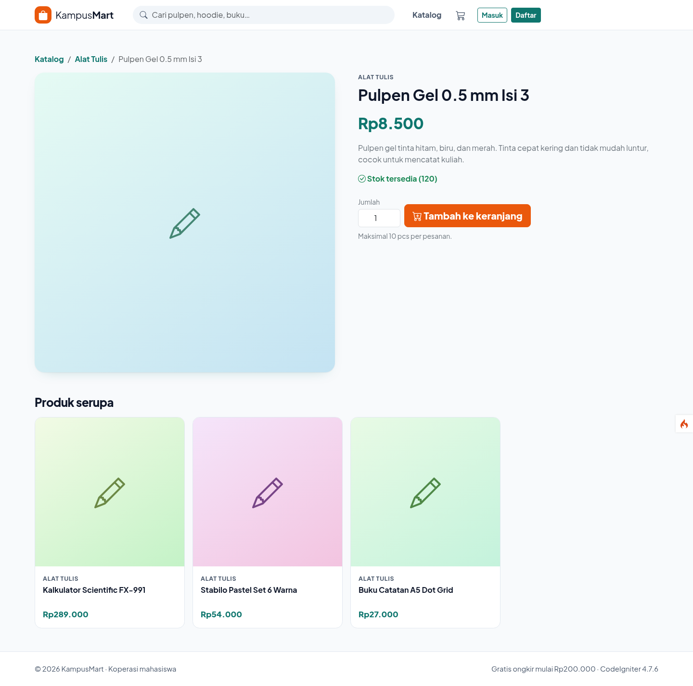

*Gambar 36. Detail produk dengan harga, stok terkini, dan kontrol jumlah.*

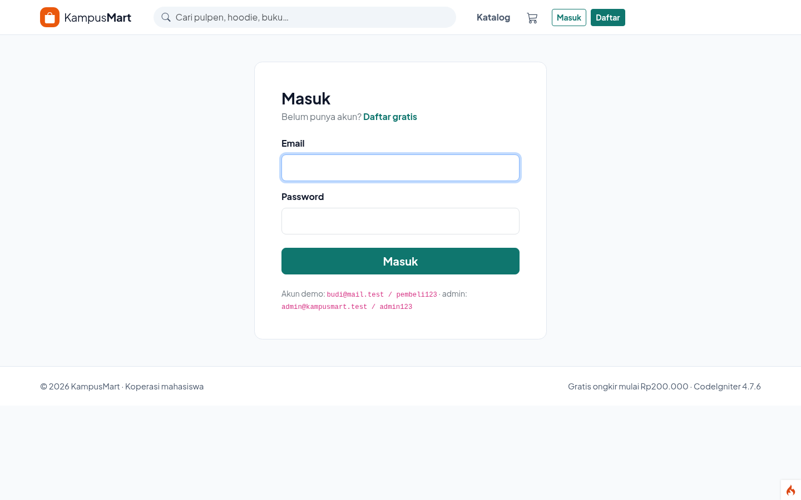

*Gambar 37. Login email pembeli dan administrator sebelum kredensial dimasukkan.*

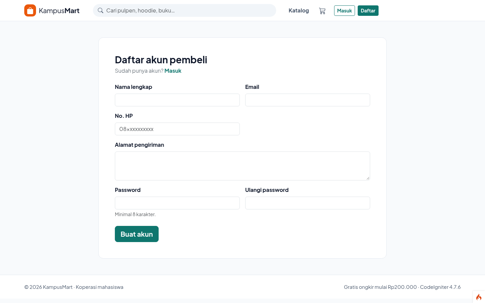

*Gambar 38. Registrasi pembeli dengan alamat dan konfirmasi password.*


### 6.2 Skema data dan snapshot pesanan

| Tabel | Kolom dan tujuan utama |
|---|---|
| `users` | email unik, hash password, role, telepon dan alamat pembeli |
| `kategori` | nama, slug unik dan ikon |
| `produk` | kategori_id, nama, slug, harga, stok, foto dan aktif |
| `orders` | kode, pembeli, subtotal, ongkir, total, status, penerima, bukti, resi |
| `order_items` | order_id, produk_id, nama_produk, harga, qty dan subtotal |

Produk tetap terhubung ke order_items, tetapi nama_produk dan harga juga disalin saat checkout. Karena itu perubahan harga katalog tidak menghitung ulang pesanan lama. Produk yang pernah dipesan tidak dihapus fisik; controller mengubahnya menjadi nonaktif. Kategori yang masih berisi produk ditolak ketika hendak dihapus.

### 6.3 Keranjang, ongkir dan checkout

Keranjang disimpan di session sebagai pasangan ID produk–qty, bukan sebagai harga yang dipercaya dari browser. Isi keranjang dibaca ulang dari database untuk mendapatkan stok, harga dan status aktif terbaru. Setiap produk dibatasi 10 pcs; penambahan berulang tetap dihitung secara akumulatif. Keranjang tetap ada setelah login/registrasi karena session diregenerasi tanpa membuang isinya.

Ongkir ditentukan dari subtotal: Rp15.000 bila kurang dari Rp200.000, gratis jika mencapai ambang tersebut. Checkout memvalidasi nama penerima, telepon dan alamat. Transaksi menyimpan order dan item, memotong stok, kemudian baru mengosongkan keranjang setelah commit berhasil.


[KampusMart/app/Libraries/PesananService.php](KampusMart/app/Libraries/PesananService.php)

```php
foreach ($isi as $b) {
    $db->query('UPDATE produk SET stok = stok - ? WHERE id = ? AND stok >= ? AND aktif = 1', [$b['qty'], $b['id'], $b['qty']]);
    if ($db->affectedRows() !== 1) {
        throw new DomainException("Stok {$b['nama']} baru saja habis, silakan perbarui keranjang.");
    }
}
```


UPDATE tersebut hanya berhasil apabila produk masih aktif dan stok setidaknya sebesar qty yang diminta. Bila affectedRows bukan satu, transaksi dibatalkan. Pada pengujian historis, dua pembeli bersaing membeli stok terakhir: tepat satu berhasil dan stok tidak negatif. Saat pembeli pemenang membatalkan, stok kembali sesuai jumlah item.


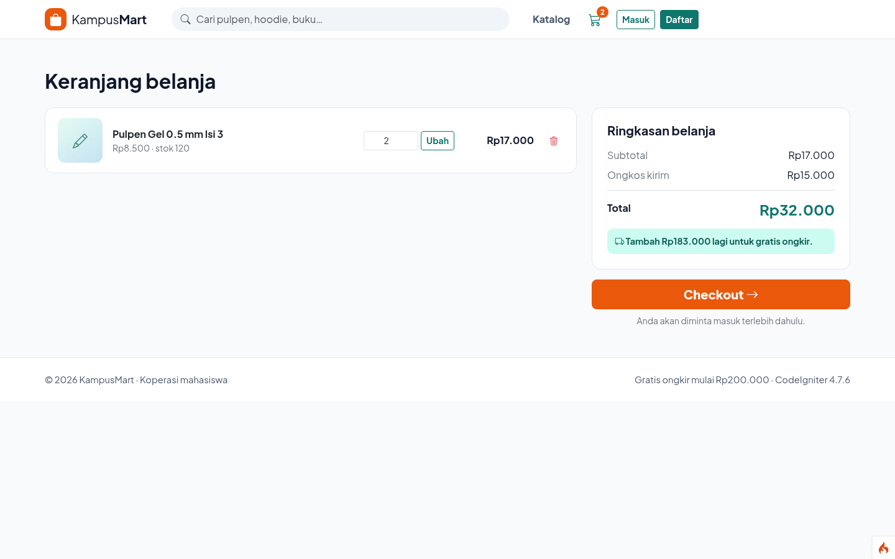

*Gambar 39. Keranjang sesi dengan form jumlah dan ringkasan ongkir; stok database tidak berubah.*

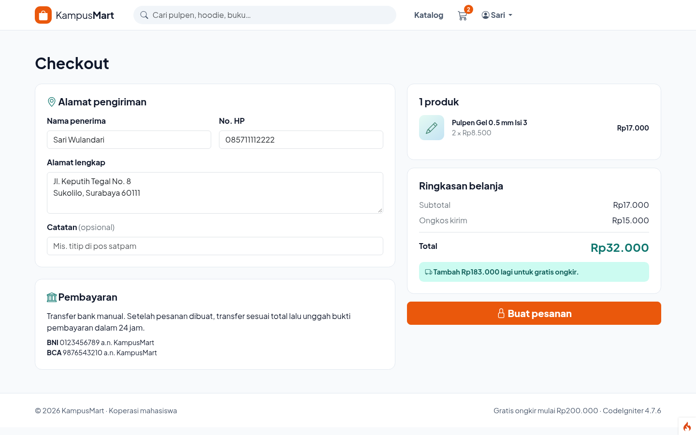

*Gambar 40. Form checkout berisi data kontak fiktif seeder; tidak ada pesanan baru dibuat.*

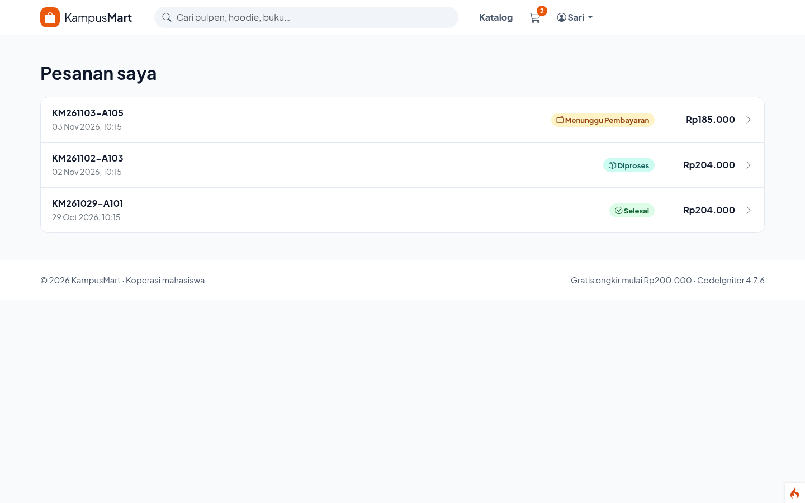

*Gambar 41. Pembeli yang login hanya melihat riwayat pesanannya sendiri.*


### 6.4 Status, pembayaran manual dan bukti privat

| Status asal | Tujuan yang diizinkan | Aktor |
|---|---|---|
| Menunggu pembayaran | Menunggu verifikasi | Pembeli, melalui upload bukti |
| Menunggu pembayaran | Dibatalkan | Pembeli atau admin |
| Menunggu verifikasi | Diproses / kembali menunggu pembayaran / dibatalkan | Admin |
| Diproses | Dikirim / dibatalkan | Admin |
| Dikirim | Selesai | Pembeli atau admin |
| Selesai / dibatalkan | Tidak ada transisi lanjutan | — |

Definisi ada pada `OrderStatus`. Pengiriman mewajibkan nomor resi. Update status menggunakan kondisi status_lama sehingga dua request pembatalan tidak mengembalikan stok dua kali. Bukti pembayaran ditolak bila bukan JPEG/PNG/WebP atau melebihi 2 MB, disimpan dengan nama acak di `writable/uploads/bukti/`, dan hanya dapat dibuka melalui controller `Bukti` oleh pemilik pesanan atau admin.


[KampusMart/app/Controllers/Bukti.php](KampusMart/app/Controllers/Bukti.php)

```php
$boleh = $order !== null
    && (session('role') === 'admin' || (int) $order['user_id'] === (int) session('user_id'));
$path  = Pesanan::FOLDER_BUKTI . $nama;

if (! $boleh || ! is_file($path)) {
    throw PageNotFoundException::forPageNotFound();
}
```


Controller memberi header `nosniff`, mengecek basename dan mengembalikan 404 jika akses tidak berhak. Bukti lama yang ditolak dihapus setelah pengganti berhasil disimpan. Rekening pada konfigurasi toko adalah contoh fiktif. Batas bayar 24 jam ditampilkan sebagai informasi; source tidak memiliki payment gateway atau scheduler pembatalan otomatis.

Screenshot berikut menggunakan pesanan seeder yang sudah ada. Tanda terima DEMO pada preview adalah file fiktif yang dipilih melalui input upload sebenarnya dan tidak dikirim. Antrean menunggu verifikasi pada database saat ini kosong; dokumentasi tidak mengubah status pesanan untuk membuat screenshot tampak lengkap. Alur verifikasi aktif sebelumnya diuji dalam E2E dan dijelaskan melalui tabel status serta kode, bukan direkayasa sebagai gambar baru.


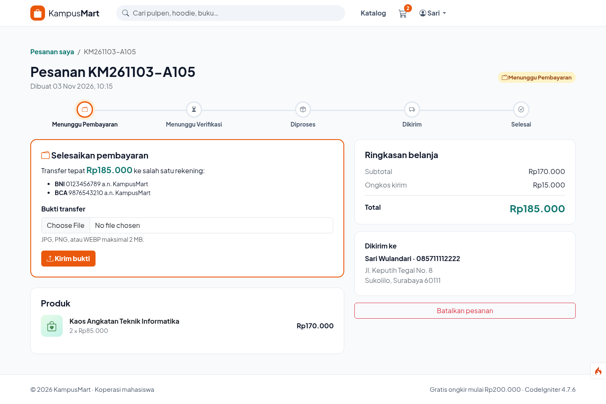

*Gambar 42. Pesanan seeder yang menunggu pembayaran, rekening transfer contoh, dan aksi pembatalan.*

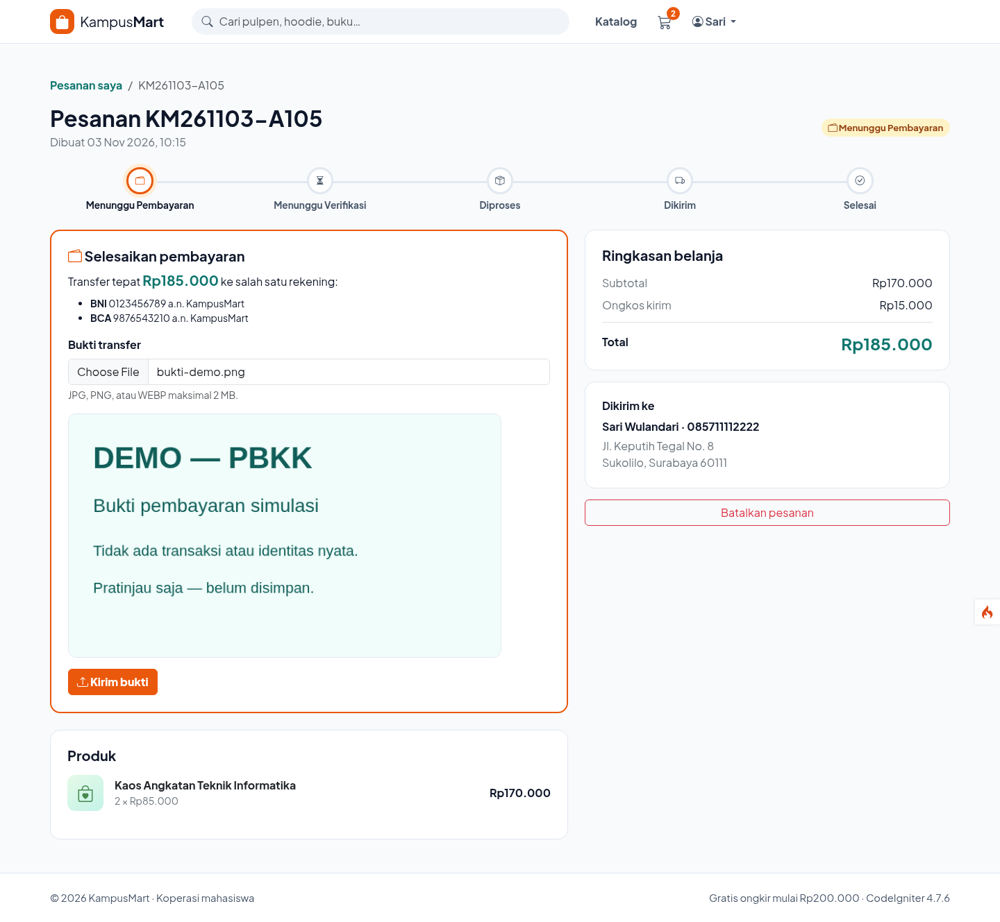

*Gambar 43. Pratinjau upload bukti asli aplikasi memakai tanda terima bertanda DEMO; tidak dikirim sehingga status tetap menunggu pembayaran.*

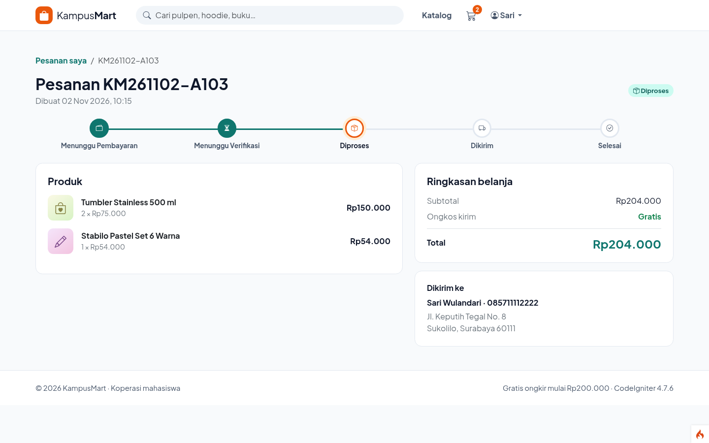

*Gambar 44. Pesanan seeder yang sudah berada pada tahap diproses.*

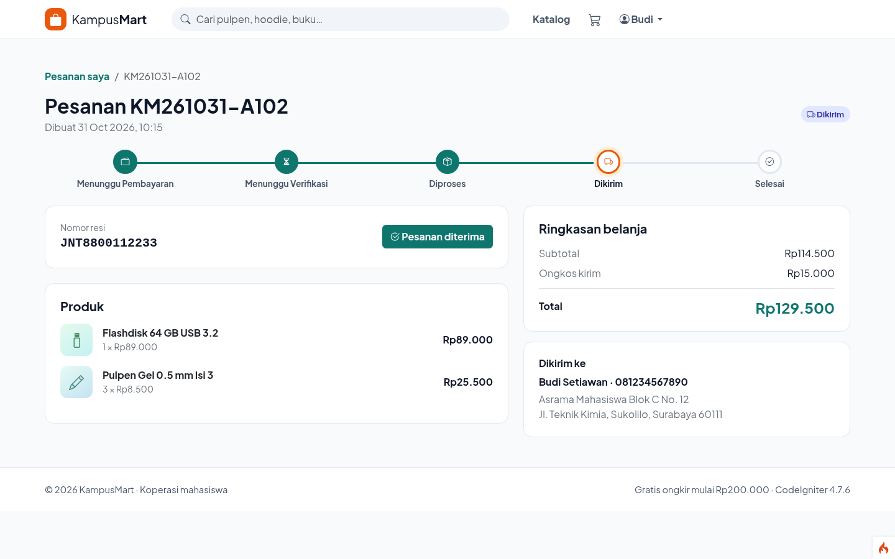

*Gambar 45. Pesanan terkirim dengan nomor resi fiktif dan tombol konfirmasi diterima.*

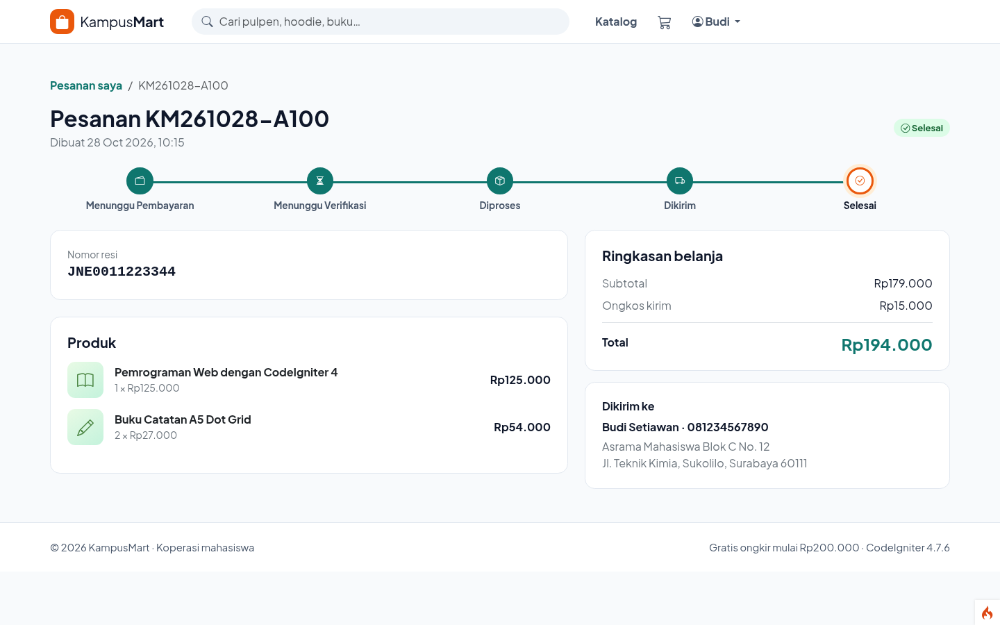

*Gambar 46. Pesanan yang sudah selesai dengan status akhirnya.*

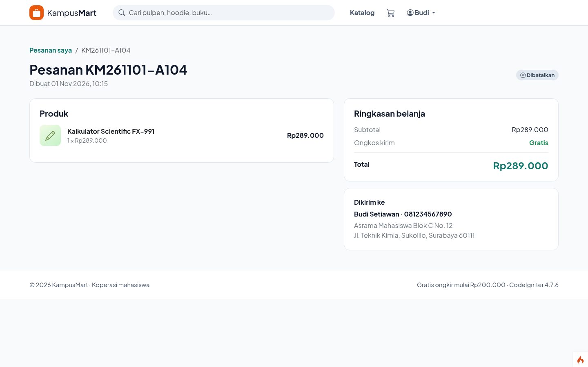

*Gambar 47. Pesanan yang sudah dibatalkan; dokumentasi tidak melakukan pembatalan baru.*


### 6.5 Administrasi, statistik dan tampilan mobile

Dashboard admin merangkum omzet, status pesanan, grafik tujuh hari dan stok tipis. CRUD produk mendukung harga dengan pemisah titik, status aktif, foto dan preview. Kategori memakai slug serta ikon. Daftar pesanan memiliki tab status dan detail penerima/item/bukti/resi, dengan tombol yang sesuai state machine.

Angka pada dashboard lokal dapat meliputi riwayat QA dari tahap implementasi sebelumnya. Repository tidak menyertakan dump database tersebut; fresh seed hanya membuat enam pesanan contoh. Produk QA yang sudah bersejarah tetap nonaktif, sesuai aturan aplikasi, dan tidak muncul pada storefront.


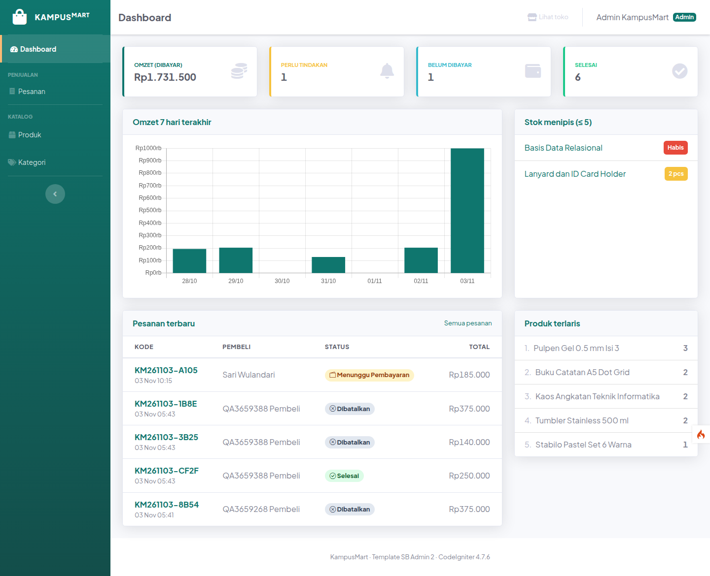

*Gambar 48. Dashboard administrator toko; riwayat audit QA lokal dapat membuat total berbeda dari seed baru.*

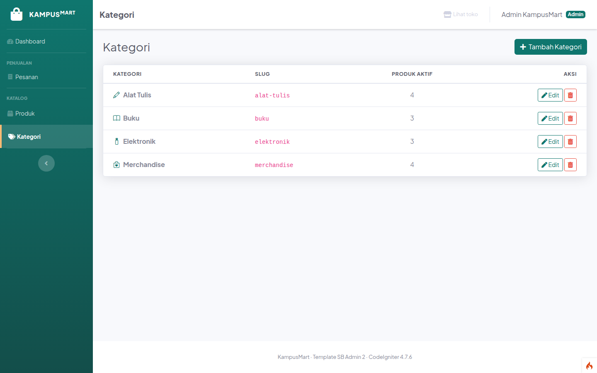

*Gambar 49. Pengelolaan kategori beserta jumlah produk.*

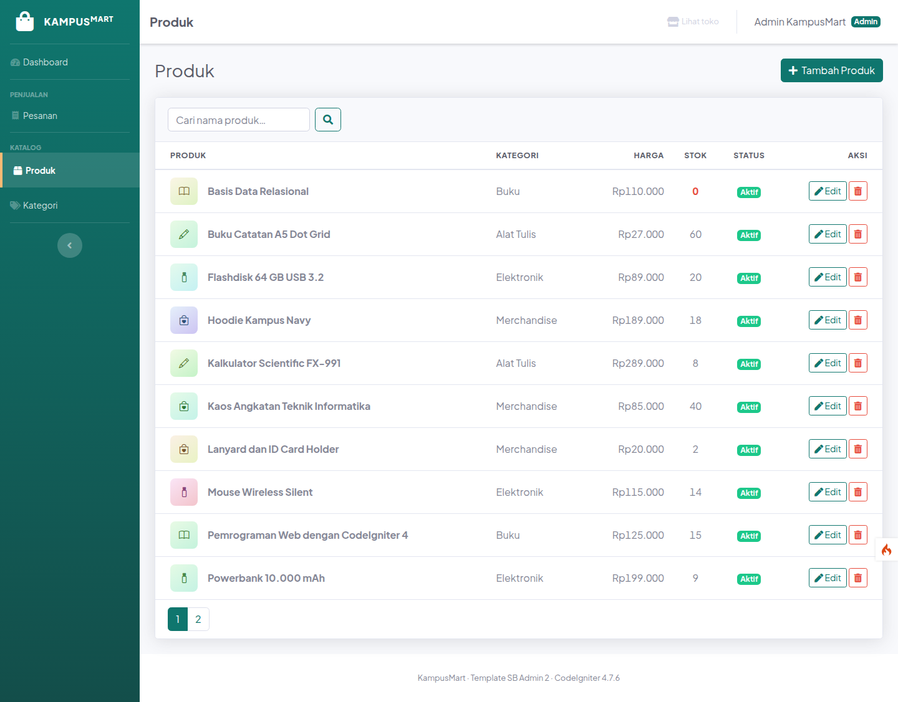

*Gambar 50. Pengelolaan produk; produk audit QA terdahulu nonaktif dan tidak tampil di toko.*


*Gambar 51. Form produk dan pratinjau gambar fiktif sebenarnya, tanpa menyimpan produk.*


*Gambar 52. Detail pesanan admin dengan aksi sah dari diproses ke dikirim dan nomor resi wajib.*


*Gambar 53. Antrean verifikasi yang sebenarnya sedang kosong. Tidak ada perubahan database untuk membuatnya terisi.*


*Gambar 54. KampusMart pada 390 × 844 dengan kartu produk dan navigasi responsif.*


## 7. Instalasi dari repository

### 7.1 Menyiapkan runtime Ubuntu

Gunakan PHP 8.2 atau lebih baru dengan intl, mbstring, MySQLi/mysqlnd, fileinfo, XML/DOM dan GD, Composer serta MySQL native. Contoh berikut adalah petunjuk pada mesin baru yang memang belum mempunyai dependency tersebut, bukan perintah yang dijalankan ulang terhadap server database yang sudah tersedia:

```bash
sudo apt update
sudo apt install php-cli php-intl php-mbstring php-mysql php-xml php-gd php-curl php-zip unzip composer
```

Jika MySQL belum tersedia, siapkan MySQL 8.4 melalui administrator sistem. Jangan memasang MariaDB/XAMPP untuk mengikuti laporan ini atau mengganti server yang sudah menyimpan database lain. Pastikan `php -v`, `php -m`, `composer --version`, dan `mysql --version` sesuai kebutuhan.

### 7.2 Mengambil source dan dependency

Nama repository yang disiapkan adalah `pbkk-week-9-codeigniter4`. URL berikut masih template sampai repository benar-benar dibuat/dipublikasikan:

```bash
git clone https://github.com/YOUR_GITHUB_USERNAME/pbkk-week-9-codeigniter4.git
cd 'pbkk-week-9-codeigniter4'
for app in StudentPortal SIAKAD KampusMart; do
  (cd "$app" && composer install)
done
```

`composer install` membaca lockfile agar versi dependency dapat direproduksi. Folder vendor tidak masuk Git. Aset vendor frontend yang dipakai SB Admin 2 tetap masuk repository; folder tersebut berbeda dari vendor Composer di root setiap aplikasi. Node/npm tidak perlu dijalankan untuk membuka tiga aplikasi.

### 7.3 Database dan akun khusus

| Direktori | Database | Contoh akun database lokal | Base URL |
|---|---|---|---|
| `StudentPortal` | `student_portal` | `studentportal` | `http://localhost:8080/` |
| `SIAKAD` | `siakad` | `siakad` | `http://localhost:8081/` |
| `KampusMart` | `kampusmart` | `kampusmart` | `http://localhost:8082/` |

Masuk melalui akun administrator MySQL lokal. SQL ini hanya untuk **instalasi baru dengan nama schema/akun yang belum ada**. Ganti tiga placeholder password dengan nilai unik secara lokal. Perintah sengaja tidak memakai DROP, ALTER USER terhadap akun lama atau reset. Jika nama sudah ada, jangan menghapusnya: tinjau konfigurasi dan hak akses yang telah dimiliki.

```sql
CREATE DATABASE student_portal CHARACTER SET utf8mb4 COLLATE utf8mb4_unicode_ci;
CREATE DATABASE siakad CHARACTER SET utf8mb4 COLLATE utf8mb4_unicode_ci;
CREATE DATABASE kampusmart CHARACTER SET utf8mb4 COLLATE utf8mb4_unicode_ci;

CREATE USER 'studentportal'@'localhost' IDENTIFIED BY 'REPLACE_WITH_UNIQUE_PASSWORD_1';
CREATE USER 'siakad'@'localhost' IDENTIFIED BY 'REPLACE_WITH_UNIQUE_PASSWORD_2';
CREATE USER 'kampusmart'@'localhost' IDENTIFIED BY 'REPLACE_WITH_UNIQUE_PASSWORD_3';

GRANT SELECT, INSERT, UPDATE, DELETE, CREATE, ALTER, INDEX, REFERENCES
  ON student_portal.* TO 'studentportal'@'localhost';
GRANT SELECT, INSERT, UPDATE, DELETE, CREATE, ALTER, INDEX, REFERENCES
  ON siakad.* TO 'siakad'@'localhost';
GRANT SELECT, INSERT, UPDATE, DELETE, CREATE, ALTER, INDEX, REFERENCES
  ON kampusmart.* TO 'kampusmart'@'localhost';
```

### 7.4 Environment per aplikasi

Salin `.env.example` ke `.env` hanya bila file lokal belum ada, kemudian isi password database sendiri. Jangan menyalin password pengguna lain atau meletakkannya dalam README. Contoh aman StudentPortal adalah:

```ini
CI_ENVIRONMENT = development
app.baseURL = 'http://localhost:8080/'
app.indexPage = ''
database.default.hostname = localhost
database.default.database = student_portal
database.default.username = studentportal
database.default.password = 'CHANGE_ME_LOCALLY'
database.default.DBDriver = MySQLi
database.default.DBPrefix = ''
database.default.port = 3306
```

Untuk SIAKAD gunakan database/user `siakad` dan port 8081. Untuk KampusMart gunakan `kampusmart` dan port 8082. Ketiga file contoh sudah disertakan pada folder masing-masing. Nama database harus sesuai guard proyek, host lokal harus localhost/127.0.0.1, dan prefix kosong. Konfigurasi aplikasi tidak memakai fitur enkripsi yang mewajibkan `spark key:generate`, sehingga langkah tersebut tidak ditambahkan tanpa kebutuhan.

```bash
for app in StudentPortal SIAKAD KampusMart; do
  if [ ! -e "$app/.env" ]; then
    cp "$app/.env.example" "$app/.env"
    chmod 600 "$app/.env"
  fi
done
```

### 7.5 Migration dan seeder pertama

Pada masing-masing direktori aplikasi, jalankan sebagai pengguna biasa:

```bash
php spark project:setup --seed
php spark migrate:status
```

Command `project:setup` memverifikasi database aktif, MySQLi, host lokal dan prefix sebelum menjalankan migration tambahan. Seeder memerlukan seluruh tabel aplikasi sudah dimigrasi dan kosong, lalu mengisi data dalam transaksi. StudentPortal memiliki empat migration; SIAKAD dan KampusMart masing-masing lima, sehingga totalnya 14. `migrations` merupakan tabel pelacak framework, terpisah dari tabel bisnis.

Pada pemakaian berikutnya cukup `php spark project:setup` tanpa `--seed`. Seeder kedua memang harus ditolak jika tabel sudah berisi data. Bila schema lama tidak memiliki riwayat migration, setup meminta peninjauan manual. Tidak ada instruksi migrate:fresh, migrate:refresh, rollback, DROP atau TRUNCATE dalam prosedur ini.

## 8. Menjalankan dan mencoba aplikasi

Jalankan tiga terminal dari direktori aplikasi masing-masing:

```bash
# Terminal 1, dari StudentPortal/
php spark serve --host 127.0.0.1 --port 8080
```

```bash
# Terminal 2, dari SIAKAD/
php spark serve --host 127.0.0.1 --port 8081
```

```bash
# Terminal 3, dari KampusMart/
php spark serve --host 127.0.0.1 --port 8082
```

URL publik StudentPortal: http://localhost:8080/ ; login SIAKAD: http://localhost:8081/login ; storefront KampusMart: http://localhost:8082/ . Server terikat loopback, bukan 0.0.0.0. Hentikan dengan Ctrl+C. Bila memakai Apache/Nginx, document root wajib mengarah ke public/ masing-masing aplikasi.

### Akun demonstrasi fiktif

| Aplikasi | Peran | Username / email | Password demo seeder |
|---|---|---|---|
| StudentPortal | Admin | `admin` | `admin123` |
| StudentPortal | Staff | `staff` | `staff123` |
| SIAKAD | Admin | `admin` | `admin123` |
| SIAKAD | Dosen | `0011018501` | `0011018501` |
| SIAKAD | Mahasiswa | `5025251001` / `5025251002` | sama dengan NIM yang dipilih |
| KampusMart | Admin | `admin@kampusmart.test` | `admin123` |
| KampusMart | Pembeli | `budi@mail.test` / `sari@mail.test` | `pembeli123` |

Password tabel ini adalah akun aplikasi yang sengaja dibuat oleh seeder untuk latihan, bukan password akun MySQL lokal. Akun lain dosen/mahasiswa mengikuti NIDN/NIM sebagai password awal. Jangan memakai akun demo ini pada layanan produksi publik.

Alur penilaian singkat: gunakan admin StudentPortal untuk CRUD, staff untuk membuktikan pembatasan, admin SIAKAD untuk data master, dosen untuk nilai, mahasiswa untuk KRS/KHS/transkrip, lalu pembeli dan admin KampusMart untuk checkout dan penanganan pesanan. Pada data seeder, Sistem Operasi diberi kuota tiga dan sudah penuh; produk Basis Data stok nol serta Lanyard stok dua dapat menunjukkan batas stok.

## 9. Pengujian dan hasil verifikasi

### 9.1 Bukti historis implementasi

Laporan implementasi lokal terdahulu diverifikasi terhadap file hasilnya sebelum ditulis ulang dalam dokumentasi publik. Laporan/log mentah internal tidak ikut dipublikasikan.

| Jenis bukti historis | Hasil yang tercatat |
|---|---|
| Migration terpasang | 14: StudentPortal 4, SIAKAD 5, KampusMart 5 |
| E2E berbasis HTTP dan verifikasi MySQL | 79 assertion: 17 StudentPortal, 28 SIAKAD, 34 KampusMart |
| Smoke HTTP | 59 pemeriksaan: 18, 21, 20 per aplikasi |
| Chrome | 18 pemeriksaan, nol uncaught error JS dan nol request aset gagal |
| PHPUnit workspace sebelumnya | 46 test lulus, 7 skipped, 116 assertion |
| MySQL aggregate opt-in | 1 test, 2 assertion, lulus secara terpisah |

Angka 79 adalah assertion, bukan jumlah test case. E2E tersebut mencakup CRUD, duplikat NIM, upload gambar dan executable yang ditolak, role staff/admin, pembatasan pemilik kelas/pesanan/bukti, bulk nilai atomik, SKS/kuota, dua request KRS bersamaan, checkout bersamaan, snapshot harga, status pesanan dan pengembalian stok tepat sekali.

Enam skipped pada workspace lama berasal dari contoh tes SQLite bawaan starter karena ekstensi sqlite3 tidak tersedia. Satu skipped adalah tes agregat MySQL yang opt-in dan telah dijalankan terpisah. Untuk kandidat publik, contoh starter yang tidak terkait fitur tidak disertakan; tes aplikasi yang relevan tetap ada. Karena komposisi file publik berbeda, hasil kandidat publik tidak boleh diasumsikan sama dengan hitungan workspace lama.

### 9.2 Pemeriksaan pada tahap penyiapan repository

Pada tahap ini tidak dijalankan ulang E2E yang menulis fixture ke database. Pengambilan screenshot memakai data fiktif yang sudah ada, hanya mengubah keranjang berbasis session serta preview form. Form kosong dikirim hanya untuk memperlihatkan penolakan validasi; tidak ada data valid yang disimpan. Checksum setiap tabel dibandingkan sebelum/sesudah untuk membuktikan data aplikasi tetap sama.

Pemeriksaan ulang kandidat publik mencakup Composer, route, lint, PHPUnit yang relevan, migration status secara baca-saja, render browser, aset, seluruh referensi gambar/anchor Markdown, serta pemindaian source yang akan dipublikasikan. Source diekspor tanpa vendor/.env/runtime ke path temporer untuk memeriksa kelengkapan dan menjalankan `composer install` berdasarkan lockfile. Hasil aktual dan batas pemeriksaan instalasi bersih dicatat pada [VERIFICATION.md](docs/VERIFICATION.md).

```bash
# Jalankan di direktori masing-masing aplikasi
composer validate --no-check-publish
php spark routes
vendor/bin/phpunit
```

```bash
# Opsional di KampusMart: query baca-saja terhadap DB lokal yang benar
PBKK_MYSQL_ACCEPTANCE=1 vendor/bin/phpunit tests/database/ProdukAggregateTest.php
```

Hasil ulang export kandidat publik: **45 test PHPUnit lulus, 1 skipped opt-in, 112 assertion, dan 24 pemeriksaan Chrome lulus**. Tes MySQL opt-in juga dijalankan terpisah dan lulus (1 test, 2 assertion). Seluruh 17 tabel proyek mempunyai jumlah baris dan fingerprint isi yang sama sebelum/sesudah. Migration/seeder pada database baru tidak diulang pada tahap ini.

### 9.3 Batas bukti dan screenshot

Antrean menunggu verifikasi dan inbox kontak sedang kosong. Kondisi itu tetap terlihat, bukan diisi dengan perubahan data hanya untuk gambar. Alur verifikasi dibuktikan melalui implementasi, hasil E2E historis dan detail tahap lain yang memang tersedia. Bukti pembayaran dalam screenshot adalah preview DEMO yang belum dikirim. Cetak fisik ke printer tidak diklaim; render cetak dan ekspor PDF pernah diuji. Driver coverage tidak tersedia sehingga persentase coverage tidak dilaporkan.

Seluruh caption membedakan data tersimpan dengan preview. Screenshot desktop memakai viewport 1440 × 900 dan perwakilan mobile 390 × 844, dengan full-page capture bila konten lebih panjang. Tidak ada screenshot PDF/README mahasiswa lain, password database, cookie, token developer, atau debug toolbar yang dibuka.

## 10. Kendala teknis dan penyelesaian

| Temuan nyata | Penyelesaian pada implementasi/persiapan |
|---|---|
| Panduan memakai XAMPP, mesin memakai MySQL native | Gunakan PHP/MySQL yang sudah tersedia; tidak mengganti layanan database |
| Koneksi StudentPortal awalnya Access denied | Provisioning lokal berizin pada tahap implementasi; rahasia tetap di .env, bukan di repository |
| Cookie tiga aplikasi pada localhost dapat bertabrakan | Nama cookie session dan CSRF berbeda per aplikasi |
| Pengecekan SKS di luar transaksi berpotensi memakai total lama | Kunci mahasiswa dan kelas sebelum menghitung/memasukkan KRS |
| Dua checkout memperebutkan stok yang sama | UPDATE bersyarat, transaksi dan pengecekan affectedRows |
| LEFT JOIN pesanan batal masih ikut SUM terlaris | CASE pada agregat hanya menghitung order yang lolos kondisi non-batal |
| Aturan gitignore vendor juga menyembunyikan aset frontend | Ubah pola app menjadi /vendor/; vendor SB Admin tetap tersedia di hasil export |
| README proyek lama menautkan toolkit internal | Tulis ulang dokumentasi developer dengan link publik yang tersedia |
| Gambar seluruh tahap tidak dapat dibuat tanpa menulis DB | Gunakan state seeder yang ada dan jelaskan antrean yang kosong secara jujur |

Penyesuaian dokumentasi ini tidak mengubah controller, model, migration, seeder, view, konfigurasi bisnis atau isi database. Perubahan app hanya pada README, contoh environment dan aturan seleksi Git. Source latihan tetap dapat ditelusuri langsung melalui tautan file.

## 11. Pembelajaran

Latihan CRUD memperlihatkan bahwa validasi tidak cukup diletakkan di browser. Model membatasi field dan nilai, controller menjaga alur request, filter memeriksa hak akses, sementara database menjaga keunikan dan relasi. Pemisahan tersebut membuat penolakan data lebih konsisten dan kesalahan lebih mudah dicari.

Pada SIAKAD, perhitungan akademik dapat diuji tanpa tampilan karena ditempatkan dalam layanan tersendiri. Pada KampusMart, transaksi dan pengecekan status lama memperlihatkan perbedaan antara proses yang terlihat benar saat dijalankan satu orang dengan proses yang tetap benar ketika request datang bersamaan. Kebutuhan dokumentasi juga memperlihatkan pentingnya membedakan state tersimpan, preview, bukti pengujian historis dan pemeriksaan yang benar-benar diulang.

Repository tunggal membantu penilaian tiga latihan tanpa mencampurkan akun atau tabelnya. Contoh environment, lockfile, aset frontend lokal dan dokumentasi instalasi menjadi bagian dari hasil kerja: source yang berjalan di laptop perlu tetap dapat dipasang ulang tanpa membagikan database atau rahasia pribadi.

## 12. Referensi

- Panduan PBKK Week 9 yang digunakan sebagai persyaratan implementasi: StudentPortal, SIAKAD dan KampusMart. Dokumen internal tersebut tidak dipublikasikan ulang sebagai source atau gambar.
- [CodeIgniter 4 — dokumentasi resmi](https://codeigniter.com/), [kebutuhan server](https://www.codeigniter.com/user_guide/intro/requirements.html), dan [perbandingan peningkatan CI3 ke CI4](https://codeigniter.com/user_guide/installation/upgrade_4xx.html).
- [SB Admin 2](https://github.com/StartBootstrap/startbootstrap-sb-admin-2) beserta atribusi Bootstrap, jQuery, Font Awesome dan Chart.js pada aset yang disertakan.
- Source dan tes aktual di [StudentPortal](StudentPortal/), [SIAKAD](SIAKAD/) dan [KampusMart](KampusMart/).

PDF/README mahasiswa lain tidak tersedia pada folder referensi lokal ketika pengerjaan dokumentasi ini. Struktur laporan disusun dari kebutuhan tugas dan kode sendiri; tidak ada isi atau gambar referensi mahasiswa lain yang disalin. Identitas laporan tetap **William Hans Chandra, 5025241138, Pemrograman Berbasis Kerangka Kerja D**.
