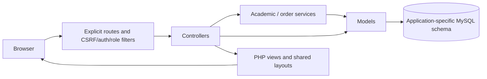

# Architecture and source map

[English overview](../README.md) · [Laporan akademik](../README.id.md)

Three independent CodeIgniter applications share a repository, not a runtime database or authentication session. Each app has its own bootstrap, explicit routes, app configuration, models, views, controllers, migrations, seeders and runtime directories.

| Area | StudentPortal | SIAKAD | KampusMart |
|---|---|---|---|
| Database | student_portal | siakad | kampusmart |
| Domain service | Model rules and controllers | KrsService, Penilaian | Keranjang, PesananService, OrderStatus |
| Public layout | Bootstrap 5 portal | Login then role-specific SB Admin | Bootstrap 5 store |
| Admin layout | SB Admin 2 | SB Admin 2 for all signed-in roles | SB Admin 2 |
| Identity | Admin/staff | Admin/lecturer/student | Admin/buyer |
| Dynamic uploads | Public student photos | None | Public product photos, private proof files |

## Concrete source entry points

- [StudentPortal routes](../StudentPortal/app/Config/Routes.php), [directory controller](../StudentPortal/app/Controllers/Direktori.php), [student model](../StudentPortal/app/Models/MahasiswaModel.php) and [public layout](../StudentPortal/app/Views/layouts/public.php).
- [SIAKAD routes](../SIAKAD/app/Config/Routes.php), [academic config](../SIAKAD/app/Config/Akademik.php), [study-plan service](../SIAKAD/app/Libraries/KrsService.php), [grade/GPA calculation](../SIAKAD/app/Libraries/Penilaian.php) and [lecturer grading](../SIAKAD/app/Controllers/Dosen/Kelas.php).
- [KampusMart routes](../KampusMart/app/Config/Routes.php), [cart](../KampusMart/app/Libraries/Keranjang.php), [order transaction service](../KampusMart/app/Libraries/PesananService.php), [state machine](../KampusMart/app/Libraries/OrderStatus.php) and [proof access controller](../KampusMart/app/Controllers/Bukti.php).
- Each app's `app/Commands/ProjectSetup.php` and `app/Libraries/DemoSeedGuard.php` validate the exact local database before additive setup and refuse demo inserts into populated tables.

## Important boundaries

Role filters run on the server; ownership checks go further than role membership. A lecturer cannot grade another lecturer's class, and a buyer cannot open another buyer's order or proof. Individual session and CSRF cookie names prevent collisions across localhost ports.

KRS uses a student row lock before checking aggregate credits and a class lock/current read before counting participants. Checkout uses conditional stock deduction, transaction checks and immutable item snapshots. Status updates compare the previous status, so repeated cancellation cannot return stock twice.

Only public/ is a web document root. The writable/ markers establish runtime directories without publishing their contents. Composer vendor/ is installed locally; the similarly named SB Admin frontend vendor directory is a required public asset and is deliberately retained. No root-level LICENSE is added; existing upstream notices remain.
