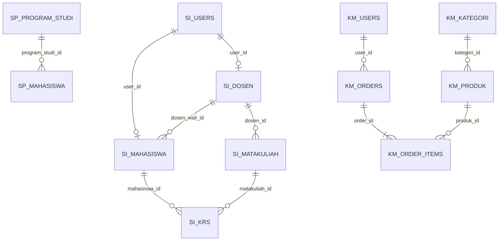

# Database tables and relationships

[English overview](../README.md) · [Laporan akademik](../README.id.md)

Schemas are independent. All table/column names below come from the migration files. No data rows, password hashes, database passwords or SQL dumps are included. Each app also has the CodeIgniter migrations tracking table.

## StudentPortal

### users

[Migration](../StudentPortal/app/Database/Migrations/2026-11-02-000001_CreateUsersTable.php)

| Column | SQL type |
|---|---|
| `id` | `INT` |
| `nama` | `VARCHAR` |
| `username` | `VARCHAR` |
| `password_hash` | `VARCHAR` |
| `role` | `ENUM` |
| `created_at` | `DATETIME` |
| `updated_at` | `DATETIME` |
### program_studi

[Migration](../StudentPortal/app/Database/Migrations/2026-11-02-000002_CreateProgramStudiTable.php)

| Column | SQL type |
|---|---|
| `id` | `INT` |
| `kode` | `VARCHAR` |
| `nama` | `VARCHAR` |
| `slug` | `VARCHAR` |
| `fakultas` | `VARCHAR` |
| `deskripsi` | `TEXT` |
| `created_at` | `DATETIME` |
| `updated_at` | `DATETIME` |
### mahasiswa

[Migration](../StudentPortal/app/Database/Migrations/2026-11-02-000003_CreateMahasiswaTable.php)

| Column | SQL type |
|---|---|
| `id` | `INT` |
| `nim` | `VARCHAR` |
| `nama` | `VARCHAR` |
| `email` | `VARCHAR` |
| `program_studi_id` | `INT` |
| `angkatan` | `SMALLINT` |
| `ipk` | `DECIMAL` |
| `foto` | `VARCHAR` |
| `created_at` | `DATETIME` |
| `updated_at` | `DATETIME` |

Foreign keys:
- `program_studi_id` → `program_studi.id`; ON UPDATE CASCADE, ON DELETE RESTRICT.
### pesan

[Migration](../StudentPortal/app/Database/Migrations/2026-11-02-000004_CreatePesanTable.php)

| Column | SQL type |
|---|---|
| `id` | `INT` |
| `nama` | `VARCHAR` |
| `email` | `VARCHAR` |
| `subjek` | `VARCHAR` |
| `isi` | `TEXT` |
| `created_at` | `DATETIME` |
| `updated_at` | `DATETIME` |

## SIAKAD

### users

[Migration](../SIAKAD/app/Database/Migrations/2026-11-02-100001_CreateUsersTable.php)

| Column | SQL type |
|---|---|
| `id` | `INT` |
| `username` | `VARCHAR` |
| `password_hash` | `VARCHAR` |
| `nama` | `VARCHAR` |
| `role` | `ENUM` |
| `created_at` | `DATETIME` |
| `updated_at` | `DATETIME` |
### dosen

[Migration](../SIAKAD/app/Database/Migrations/2026-11-02-100002_CreateDosenTable.php)

| Column | SQL type |
|---|---|
| `id` | `INT` |
| `user_id` | `INT` |
| `nidn` | `VARCHAR` |
| `email` | `VARCHAR` |
| `created_at` | `DATETIME` |
| `updated_at` | `DATETIME` |

Foreign keys:
- `user_id` → `users.id`; ON UPDATE CASCADE, ON DELETE CASCADE.
### mahasiswa

[Migration](../SIAKAD/app/Database/Migrations/2026-11-02-100003_CreateMahasiswaTable.php)

| Column | SQL type |
|---|---|
| `id` | `INT` |
| `user_id` | `INT` |
| `nim` | `VARCHAR` |
| `email` | `VARCHAR` |
| `angkatan` | `SMALLINT` |
| `dosen_wali_id` | `INT` |
| `created_at` | `DATETIME` |
| `updated_at` | `DATETIME` |

Foreign keys:
- `user_id` → `users.id`; ON UPDATE CASCADE, ON DELETE CASCADE.
- `dosen_wali_id` → `dosen.id`; ON UPDATE CASCADE, ON DELETE RESTRICT.
### matakuliah

[Migration](../SIAKAD/app/Database/Migrations/2026-11-02-100004_CreateMatakuliahTable.php)

| Column | SQL type |
|---|---|
| `id` | `INT` |
| `kode` | `VARCHAR` |
| `nama` | `VARCHAR` |
| `sks` | `TINYINT` |
| `semester` | `TINYINT` |
| `dosen_id` | `INT` |
| `kuota` | `SMALLINT` |
| `created_at` | `DATETIME` |
| `updated_at` | `DATETIME` |

Foreign keys:
- `dosen_id` → `dosen.id`; ON UPDATE CASCADE, ON DELETE RESTRICT.
### krs

[Migration](../SIAKAD/app/Database/Migrations/2026-11-02-100005_CreateKrsTable.php)

| Column | SQL type |
|---|---|
| `id` | `INT` |
| `mahasiswa_id` | `INT` |
| `matakuliah_id` | `INT` |
| `tahun_ajaran` | `VARCHAR` |
| `semester` | `ENUM` |
| `nilai_angka` | `DECIMAL` |
| `nilai_huruf` | `VARCHAR` |
| `created_at` | `DATETIME` |
| `updated_at` | `DATETIME` |

Foreign keys:
- `mahasiswa_id` → `mahasiswa.id`; ON UPDATE CASCADE, ON DELETE CASCADE.
- `matakuliah_id` → `matakuliah.id`; ON UPDATE CASCADE, ON DELETE RESTRICT.

## KampusMart

### users

[Migration](../KampusMart/app/Database/Migrations/2026-11-02-200001_CreateUsersTable.php)

| Column | SQL type |
|---|---|
| `id` | `INT` |
| `nama` | `VARCHAR` |
| `email` | `VARCHAR` |
| `password_hash` | `VARCHAR` |
| `role` | `ENUM` |
| `telepon` | `VARCHAR` |
| `alamat` | `TEXT` |
| `created_at` | `DATETIME` |
| `updated_at` | `DATETIME` |
### kategori

[Migration](../KampusMart/app/Database/Migrations/2026-11-02-200002_CreateKategoriTable.php)

| Column | SQL type |
|---|---|
| `id` | `INT` |
| `nama` | `VARCHAR` |
| `slug` | `VARCHAR` |
| `ikon` | `VARCHAR` |
| `created_at` | `DATETIME` |
| `updated_at` | `DATETIME` |
### produk

[Migration](../KampusMart/app/Database/Migrations/2026-11-02-200003_CreateProdukTable.php)

| Column | SQL type |
|---|---|
| `id` | `INT` |
| `kategori_id` | `INT` |
| `nama` | `VARCHAR` |
| `slug` | `VARCHAR` |
| `deskripsi` | `TEXT` |
| `harga` | `INT` |
| `stok` | `INT` |
| `foto` | `VARCHAR` |
| `aktif` | `TINYINT` |
| `created_at` | `DATETIME` |
| `updated_at` | `DATETIME` |

Foreign keys:
- `kategori_id` → `kategori.id`; ON UPDATE CASCADE, ON DELETE RESTRICT.
### orders

[Migration](../KampusMart/app/Database/Migrations/2026-11-02-200004_CreateOrdersTable.php)

| Column | SQL type |
|---|---|
| `id` | `INT` |
| `kode` | `VARCHAR` |
| `user_id` | `INT` |
| `subtotal` | `INT` |
| `ongkir` | `INT` |
| `total` | `INT` |
| `nama_penerima` | `VARCHAR` |
| `telepon` | `VARCHAR` |
| `alamat` | `TEXT` |
| `catatan` | `VARCHAR` |
| `bukti_bayar` | `VARCHAR` |
| `resi` | `VARCHAR` |
| `catatan_admin` | `VARCHAR` |
| `created_at` | `DATETIME` |
| `updated_at` | `DATETIME` |

Foreign keys:
- `user_id` → `users.id`; ON UPDATE CASCADE, ON DELETE RESTRICT.
### order_items

[Migration](../KampusMart/app/Database/Migrations/2026-11-02-200005_CreateOrderItemsTable.php)

| Column | SQL type |
|---|---|
| `id` | `INT` |
| `order_id` | `INT` |
| `produk_id` | `INT` |
| `nama_produk` | `VARCHAR` |
| `harga` | `INT` |
| `qty` | `SMALLINT` |
| `subtotal` | `INT` |

Foreign keys:
- `order_id` → `orders.id`; ON UPDATE CASCADE, ON DELETE CASCADE.
- `produk_id` → `produk.id`; ON UPDATE CASCADE, ON DELETE RESTRICT.

## Relationship overview

The SP/SI/KM diagram prefixes are explanatory labels, not actual SQL table prefixes. StudentPortal users and messages are independent of its program/student relationship.

## Invariants and seed data

- StudentPortal: unique usernames, program codes/slugs and student NIM. A referenced program cannot be deleted. Fresh seed: 2 users, 5 programs, 12 students.
- SIAKAD: unique usernames/NIDN/NIM and one-to-one profile user IDs. KRS has a composite unique key on mahasiswa_id, matakuliah_id, tahun_ajaran and semester. Grade NULL means ungraded. Fresh seed: 14 users, 4 lecturers, 9 students, 16 courses and 83 KRS records.
- KampusMart: unique emails/slugs/order codes, integer monetary amounts, preserved order-item name/price snapshots, and guarded order transitions. Fresh seed: 3 users, 4 categories, 14 products and 6 orders. The manual-transfer bank details in Toko config are fictional examples.

The 14 migrations define down methods for framework compatibility, but destructive rollback/reset is not an installation step. The project's seed guard requires the correct local database and empty business tables. See [SETUP](SETUP.md) for the non-destructive setup process.
